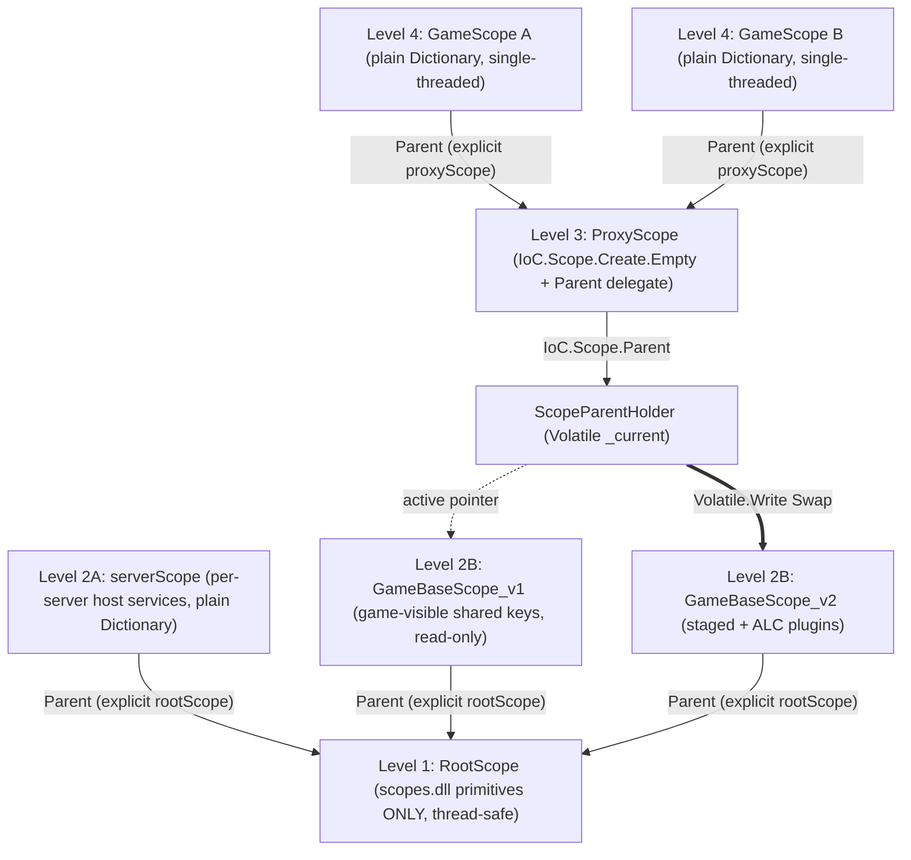
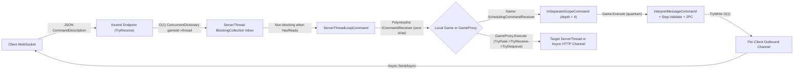
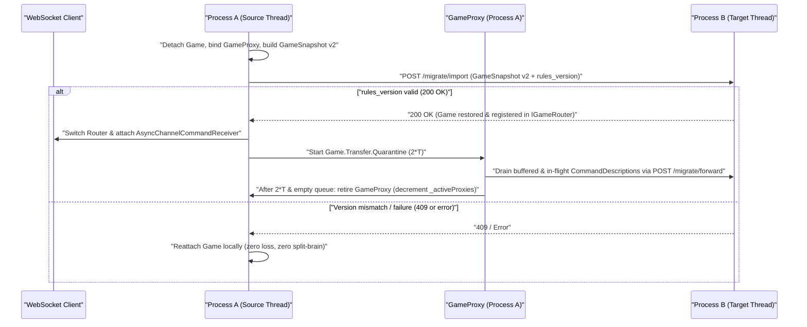

# Архитектура сервера SpaceBattle (OOAnD, 2-й семестр)

> **Назначение:** Высокоуровневый архитектурный чертёж, единый глоссарий, матрица уровней `IoC`-скоупов, критичные технические ограничения (`scopes.dll`, механические гейты) и шпаргалка к устной защите.  
> **Единый источник правды:** Точные сигнатуры `IoC`-ключей, JSON-схемы, списки `Create/Modify` файлов и планы тестов находятся исключительно в спецификациях [`docs/designs/01..05-*.md`](ROADMAP.md) (здесь не дублируются). Все архитектурные развилки зафиксированы в [`docs/DECISIONS.md`](DECISIONS.md) (`D-001..D-020`).

---

## 1. Каноническая структура репозитория и масштаб

Каноническая кодовая база — командный репозиторий (`origin/main` + объединённые Fork A `adapter-codegen` и Fork B `server-thread-queues` → `game-transfer` → `game-transactions`, `D-010`). Все команды сборки, хуки и CI (`.github/workflows/ci.yaml`) работают с корнем клона и решением в каталоге `SpaceBattle/`:

- `SpaceBattle/SpaceBattle.sln`
- `SpaceBattle/Common/` — закрытые бинарные контракты курса `core.dll` (`App.ICommand`, `App.Ioc`) и `scopes.dll` (`App.Scopes.InitCommand`, `IoC.Register`, `IoC.Scope.*`), без изменений.
- `SpaceBattle/SpaceBattle.Lib/` — доменное ядро, compile-once генератор адаптеров/фабрик (Roslyn), правила (`A before B`), иерархия скоупов и hot-reload, `ServerThread`/планировщик, `GameProxy`/миграция/снапшоты, 2PC-транзакции, коллизии и правила геймплея.
- `SpaceBattle/SpaceBattle.Server/` — тонкий хост (`Program.Main` → `ServerBootstrap`), Kestrel WebSocket-эндпоинт, $O(1)$ хеш-роутер, HTTP-маршруты 2-процессной миграции и `/admin/shutdown`.
- `SpaceBattle/SpaceBattle.Tests/` — xUnit + NSubstitute + Coverlet (**100.00% line & branch**), включая `Benchmarks/` и E2E-тесты с `ScriptedProxyAgent`.
- `SpaceBattle/Tools/` — `collision_matrix.csv` (15 477 кортежей) и `generate_matrix.py`.

**Масштаб:** ориентир «~180 файлов» взят из стороннего эталонного проекта внешнего знакомого. Наш сервер строится инкрементально как дельта **~55–75 файлов** поверх **121 уже сведённого и протестированного `.cs` файла** на `origin/*` (итого ~175–195 файлов для полного сдаваемого контура `A1–A11`).

---

## 2. Архитектурные диаграммы

### 2.1. 4-уровневая иерархия `IoC`-скоупов и Lock-Free Hot-Reload (`INV-7`, `D-012`)

*Глубина игровой цепочки поиска всегда строго **4** (`GameScope → ProxyScope → GameBaseScope_vN → RootScope`, `INV-7`). Вынос хост-ключей в отдельный соседний `Level 2A: serverScope` гарантирует, что `RootScope` остаётся чистым — два инстанса `SpaceBattle.Server` в одном xUnit-процессе не сталкиваются с `scopes.dll` Trap #1. `ScopeParentHolder` переключает ссылку `GameBaseScope_vN` через `Volatile.Read/Write` без блокировок.*

### 2.2. Конвейер обработки входящего сообщения (`D-013`, `D-014`)

### 2.3. 2-процессная Stop-and-Serialize миграция и жизненный цикл `GameProxy` (`D-014`, `D-018`)

---

## 3. Глоссарий терминов (5-way Proxy / Bridge Disambiguation)

Во избежание путаницы в коде и на устной защите запрещено использовать неквалифицированное слово «прокси». Каждому механизму соответствует строго один термин:

| Термин | Слой | Паттерн GoF | Время жизни | Ключевой контракт / Спецификация |
| :--- | :--- | :--- | :--- | :--- |
| **`ProxyScope`** | `IoC`-скоупы (Уровень 3) | **Proxy** (индирекция ссылки) | Время жизни сервера | Пустой скоуп с единственным делегатом `"IoC.Scope.Parent" -> ScopeParentHolder.Current` (`02-rules-and-scope-hot-reload.md`) |
| **`GameProxy`** | Потоки и миграция | **Proxy** (заместитель игры, LSP) | От начала миграции до истечения карантина `2*T` и опустошения очереди | `ICommand, ICommandReceiver`; неблокирующая пересылка in-flight сообщений без deadlock и с zero overhead (`04-game-proxy-2proc-migration-and-snapshot.md`) |
| **`ScriptedProxyAgent`** | Тесты (`SpaceBattle.Tests`) | **Proxy / Test Double** | Один прогон E2E-теста | Сценарная подмена внешнего игрока-агента (Игрок 1 молчит / Игрок 2 побеждает) (`05-gameplay-collisions-and-e2e.md`) |
| **`Reverse Proxy (Nginx)`** | Внешняя сеть (L7) | **Proxy** (сетевой шлюз) | Внешний сервис | Единая точка входа перед кластером инстансов `SpaceBattle.Server` *(Deferred Backlog)* |
| **`BridgeCommand` (`CommandInjectableCommand`)** | Доменные длительные действия | **Bridge** (`ПЗ_6 13:45`) | Время длительного действия | `ICommand, ICommandInjecting`; $O(1)$ подмена внутренней команды на `EmptyCommand` при `Actions.Stop` (`origin/main`) |

---

## 4. Матрица владения `IoC`-ключами по уровням скоупа

| Уровень | Скоуп (Тип хранилища) | Какие категории ключей регистрируются | Hot-Reload? |
| :- | :--- | :--- | :-: |
| **1** | **`RootScope`** (`ConcurrentDictionary`, thread-safe) | **Строго только примитивы `Common/scopes.dll`** (`IoC.Register`, `IoC.Scope.*`). Никаких per-server регистраций — два инстанса сервера в одном xUnit-процессе не сталкиваются с `scopes.dll` Trap #1. | Нет (системное ядро) |
| **2A** | **`serverScope`** (`Dictionary`, per-server host scope, child of `RootScope`) | Только хост-зависимости, резолвящиеся синхронно при старте в `ServerBootstrap`: `Server.Scope.*`, `Server.Router`, `Server.Ingress.Paused`, `Server.Admin.*`, `Server.Exceptions`, `Server.Thread.*` (включая `Server.Thread.TryEnqueue`), `Endpoint.*`, `Scopes.*` (`Scopes.HotReload`, `Scopes.Game.Create`), `Game.Transfer.Transport`, `Game.Transfer`, `Game.Transfer.Remote`, `Game.Create.Transferable`, `Game.Restore`, `Server.Snapshot.*`. | Нет (жизненный цикл хоста) |
| **2B** | **`GameBaseScope_vN`** (`Dictionary`, child of `RootScope`, read-only после публикации) | **Все ключи, резолвящиеся во время выполнения игр:** `Exception.Handle`, `Server.Connections`, `Game.Message.*`, `Commands.InterpretMessage`, `Game.State.*`, `Snapshot.Codecs`, `Game.Transfer.Quarantine*`, `Adapters.*` (`Adapters.Assemblies`, `Adapters.Factory`, `Commands.Factory`, `Adapters.Template.*`), доменные команды (`Commands.Move`, `Rotate`, `Shoot`, `Macro`, `CheckFuel`, `BurnFuel`, `CheckCollision`, `Actions.Start/Stop`), дефолтные `Commands.InTransaction` / `Game.State.Reindex`, производный `Velocity` (`[assembly: Dependency]`), загруженная `collision_matrix.csv` (`Game.Collision.*`), команды плагинов `.dll`. | **Да** (атомарный `Volatile.Write` в `ProxyScope`) |
| **3** | **`ProxyScope`** (`IoC.Scope.Create.Empty`) | **Только один ключ:** `"IoC.Scope.Parent"` → `ScopeParentHolder.Current` (`Volatile.Read`). Никаких других ключей. | Переключает указатель |
| **4** | **`GameScope`** (`Dictionary`, single-threaded) | Уникальные правила игры из `game-rules.json` (`Specs.<action>`, `Macro.<action>`, `Game.Rules.*`), `Game.Repository.{ReadOnly,Writable}`, `Game.Transactions`, `Game.Item.Create`, `Game.Item.Transactional`, `Game.Loop.{CanContinue,Idle}`, `Game.Step.*`, `Game.Command.Receiver` (единый транзакционный outbox), `Game.Actions.Registry`, Read Model состояния и победы. | Наследует `Level 2B` через `ProxyScope` |

---

## 5. Критичные технические ограничения (`scopes.dll`, гейты и 100% покрытие)

Этот раздел заменяет отдельный `AGENT_GUIDE.md` — все будущие агенты обязаны учитывать его перед редактированием `.cs` файлов.

### 5.1. Пять верифицированных ловушек `Common/scopes.dll`
1. **Запрет повторного `IoC.Register` в том же скоупе:** бросает `ArgumentException: An item with the same key has already been added`. Следствие: `ProxyScope` нельзя создавать через `IoC.Scope.Create` с последующим `IoC.Register("IoC.Scope.Parent", ...)`.
2. **Паралич пустого скоупа:** после `IoC.Scope.Current.Set(emptyScope)` любой `Ioc.Resolve` (включая `IoC.Register` и обратный `IoC.Scope.Current.Set`) бросает `KeyNotFoundException: 'IoC.Scope.Parent'`. Следствия: (а) `InSeparateScopeCommand` резолвит команду восстановления **до** входа в целевой скоуп; (б) `ProxyScopeFactory` задаёт `((IDictionary<string, Func<object[], object>>)emptyScope)["IoC.Scope.Parent"] = _ => holder.Current` **до** первой активации скоупа.
3. **Неявное углубление скоупов:** 0-аргументный `IoC.Scope.Create` наследует текущий `IoC.Scope.Current` и способен незаметно пробить лимит `depth <= 4` (`INV-7`). Всегда передавать `parent` явно (`rootScope` для `GameBaseScope`, `proxyScope` для `GameScope`).
4. **Слепая ошибка поиска:** при отсутствии ключа вплоть до корня бросается `Exception: The root scope has no a parent scope.` без имени ключа — проверяйте точное написание ключей по спецификациям `01..05`.
5. **Неинициализированный контейнер:** `new InitCommand().Execute()` обязан вызываться в начале каждого тестового класса (с изоляцией дочерним скоупом) и в `ServerBootstrap`.

### 5.2. Правила выживания в `ooand-lint-gate.py` и `stop-verify-gate.py` (`D-017`)
- **Рабочий корень:** разработка ведётся строго из корня клона с `SpaceBattle/SpaceBattle.sln` (путь `контекст/` игнорируется всеми хуками!).
- **Жёсткие запреты линтера в `src`:** (1) `switch` (и оператор, и `switch`-выражение!) запрещён **даже в infra-файлах** — используйте `Dictionary` / `IoC`; (2) интерфейсы `I*able`/`I*eble` запрещены везде (`INV-5` — вместо `IDestroyable`/`ITransferable` использовать `IDestroyingObject`/`IGameTransferring`); (3) `IDictionary<string, object>` запрещён в не-infra `*Command.cs`; (4) `Activator.CreateInstance` разрешён только в `*Factory*.cs`/`*Compiler*.cs`; (5) подстрока `"IoC.Scope"` запрещена в любой строке `Game.cs`; (6) любые комментарии (`//`, `/* */`, `///`) и `Skip=` запрещены во всех `.cs` (включая тесты).
- **Изоляция `new` (`INV-1`):** любые `new` типов вне `ALLOWED_NEW_TYPES` (`WebSocket`, `Channel`, `HttpClient`, `JsonSerializerOptions`, `AssemblyLoadContext`, `BlockingCollection`, `Thread`, `StreamReader`, DTO) размещать **только** в файлах с маркерами `INFRA_FILE_MARKERS`: `Register`, `Factory`, `Compiler`, `Generator`, `Builder`, `Init`, `Bootstrap`.
- **100.00% line & branch Coverlet (`INV-8`):**
  - **Запрет `record`/`record struct` в продакшн-коде** (компилятор генерирует непокрытые ветки `Equals`/`PrintMembers`/`<Clone>$`).
  - Никаких защитных `?.`/`??` на ненулевых полях и никаких лишних `async`/`await`-обёрток.
  - **`Program.Main`:** `public static Task Main(string[] args) => ServerBootstrap.RunAsync(args, CancellationToken.None);` (0 веток state-machine; 100% покрытие через `/admin/shutdown`).
  - **Обязательные швы:** `FakeWebSocket : WebSocket`, `HttpMessageHandler`, `"Game.Transfer.Quarantine"`, компиляция временного плагина `.dll` через Roslyn в тестах (без переопределения `AssemblyLoadContext.Load`), `TextReader` для CSV, diamond DAG для Кана.
  - **Порядок перед `spec-review`:** сначала `dotnet format`, затем `stop-verify-gate.py --print-sha`, затем `spec-review` (иначе форматирование сломает `reviewed_sha` в `.dev/.last-review.md`).

---

## 6. Шпаргалка к устной защите (`ПЗ_1`–`ПЗ_6`)

### 6.1. Карта естественно применённых паттернов GoF (YAGNI, без искусственных классов)

| Паттерн GoF | Где применён в SpaceBattle | Обоснование / антипаттерн |
| :--- | :--- | :--- |
| **Command** | `App.ICommand`, `MoveCommand`, `RotateCommand`, `ShootCommand`, `Game`, `GameProxy`, `InSeparateScopeCommand`, `InTransactionCommand` | Единый полиморфный контракт исполнения, очередей и планировщика. |
| **Composite** | `MacroCommand` | Композиция произвольной глубины под тем же `ICommand` (LSP). |
| **Adapter** | Roslyn-генерируемые адаптеры (`IMovingObject`, `IRotatingObject`, `IFuelBurningObject`, ...) | Убирает прямой доступ к `IDictionary` и касты (`INV-2`, `INV-6`). |
| **Abstract Factory** | `Ioc.Resolve<T>` (эволюция к одному методу ради OCP, `ПЗ_5 12:30`), `IAdapterFactory`, `ICommandFactory` | Скрывает конкретный тип, политику инстанцирования и параметры (`INV-1`). |
| **Proxy** | `GameProxy` (пересылка при миграции), `ProxyScope` (indirection для hot-reload), `ScriptedProxyAgent` (E2E) | Тот же контракт (`ICommand`/скоуп/агент) без правок вызывающего кода (LSP). |
| **Bridge** | `CommandInjectableCommand` (`BridgeCommand`, `ПЗ_6 13:45`) | Прозрачная подмена реализации действия на `EmptyCommand` при `Actions.Stop` за $O(1)$. |
| **Strategy** | Делегаты `IoC`, `CreateMacroCommandStrategy`, `SnapshotValueCodecs`, `"Game.Step.Validate"`, `"Game.Collision.Event.*"` | Подмена алгоритмов и правил без `switch` и правок команд (`INV-2`, `INV-3`). |
| **Chain of Responsibility** | Иерархия `IoC`-скоупов (`GameScope → ProxyScope → GameBaseScope → RootScope`) | Делегирование поиска зависимости вверх по цепочке `Parent` (`depth <= 4`). |
| **Decorator** | `InSeparateScopeCommand`, `InTransactionCommand`, `SchedulingCommandReceiver`, `TransactionalGameObjectRepository`, `TransactionalCommandReceiver` | Прозрачное добавление скоупов, транзакций и планирования без правки `Game` (`INV-3`, `INV-7`). |
| **State** | `ServerThreadState` (`Normal` / `SoftStop` / `HardStop`), `Active` / `Idle` состояния игры в `RoundRobinGameScheduler` | Изменение поведения цикла потока и планировщика без `switch`. |
| **Builder** | `AdapterSourceBuilder`, `CommandFactorySourceBuilder`, `GameSnapshotBuilder` *(без `Result` в общем интерфейсе билдера, `ПЗ_5 36:00`)* | Пошаговое накопление представления и переиспользование обхода (`Director`). |
| **Interpreter** | `InterpretMessageCommand` + парсер `game-rules.json` | Перевод декларативного JSON в `ICommand` / `IoC.Register` в скоупе игры. |
| **Memento** | `GameSnapshot` / `ServerSnapshot` (`GameSnapshotSerializer`) | Вынос сериализуемого состояния без раскрытия внутренних деталей (`shutdown & restore`, миграция). |
| **Null Object** | `EmptyCommand` (`"Commands.Empty"`) | Безопасная заглушка для `Actions.Stop` без проверок `if (cmd != null)`. |
| **Singleton (ЗАПРЕЩЁН!)** | **Намеренно отсутствует** (`ПЗ_5 14:40`) | Антипаттерн Service Locator (Фаулер), ломает подмену однопоточной/многопоточной политики; заменён стратегией в `IoC`. |

### 6.2. Асимптотическая сложность ключевых узлов

| Операция | Сложность | Механизм |
| :--- | :-: | :--- |
| Маршрутизация сообщения на эндпоинте (`gameId -> thread`) | **$O(1)$** | `ConcurrentDictionary<string, ICommandReceiver>` |
| Остановка длительного действия (`Actions.Stop`) | **$O(1)$** | Подмена ссылки в `CommandInjectableCommand` (`Bridge`), без $O(N)$ скана очереди |
| Переключение версии при Hot-Reload (`ProxyScope`) | **$O(1)$** | Атомарный `Volatile.Write` единственного указателя `ScopeParentHolder` |
| Поиск зависимости в иерархии `IoC`-скоупов | **$O(1)$** ($\le 4$ шага) | Ограниченная глубина 4 (`Root ← GameBase ← Proxy ← Game`), хеш-поиск в `Dictionary` |
| Проверка коллизии по матрице (`Game.Collision.Check`) | **$O(1)$** | Предвычисленный `HashSet<(int,int,int,int)>` из `collision_matrix.csv` (15 477 кортежей) |
| Чтение свойства в транзакции (`TransactionalGameItem.TryGetValue`) | **$O(d)$** ($d \approx 0..1$) | Прямой поиск по стеку журналов без аллокации `Dictionary` (`D-015`) |
| Сборка порядка `MacroCommand` (`A before B`) | **$O(V + E)$** | Алгоритм Кана с индексным тай-брейком и дедупликацией рёбер (`D-011`) |

### 6.3. Теоретико-множественное обоснование LSP, OCP и 4D-модели (`ПЗ_1:265-543`, `ПЗ_2:293-365`)
- **LSP и `MacroCommand`:** Подтип $B \subseteq A \iff (P_B(x) \to P_A(x))$ обязан быть замкнут относительно всех операций $A$ (контрпример Квадрат/Прямоугольник). Наследование фиксирует структуру на этапе компиляции и приводит к пустым пересечениям предикатов; композиция `MacroCommand` сужает множество допустимых объектов динамически в runtime, сохраняя базовый инвариант (пока `MoveCommand` остаётся внутри `MacroCommand`), и позволяет менять правила per-game без правок кода (**OCP**, `INV-3`).
- **4D-модель (`-ing` vs `-able`, `INV-5`):** Интерфейс `IMovingObject` описывает объект *в процессе движения* (ненулевая скорость, постусловие `Move`: позиция гарантированно изменилась). Интерфейс `IMovable` допускал бы стоящий корабль с нулевой скоростью, разрушая тестируемость постусловия.
