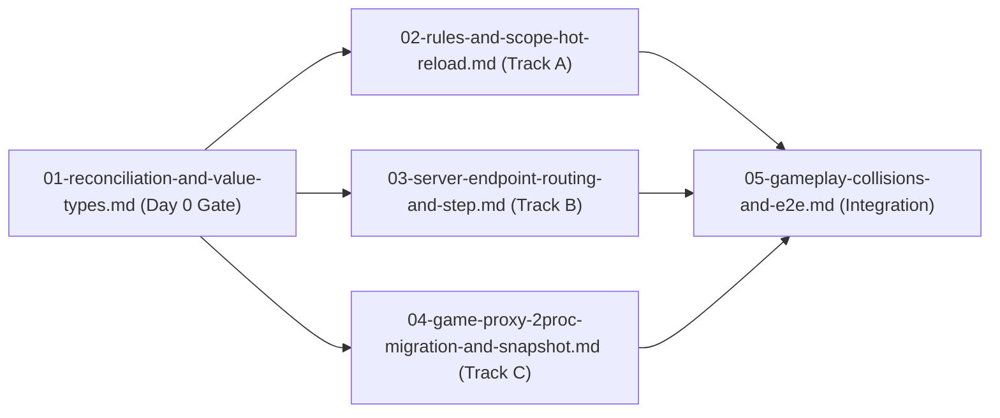

# Дорожная карта SpaceBattle Server (5 дельта-спецификаций)

> База: `121` `.cs` файл на `origin/*` (Fork A + Fork B @ 100%/100%) + дельта `~55–75` файлов (`D-010..D-019`). Архитектура и ловушки: [`docs/ARCHITECTURE.md`](ARCHITECTURE.md).

## 1. Граф зависимостей спецификаций (DAG)

## 2. Матрица распараллеливания команды (0 пересечений файлов)

| Спецификация (`docs/designs/`) | Трек / Владелец | Дельта-объём (ключевые артефакты) | Критерий готовности (DoD) |
| :--- | :--- | :--- | :--- |
| **`01-reconciliation-and-value-types.md`** | **Day 0 Gate** (Максим) | Merge Fork A (`b0f65b0`) + Fork B (`dd1fe75`), `D-001..D-009` + `D-010..D-021`, CI `SpaceBattle/`, `Angle` (`readonly struct`, `INV-8`) / `Vector` (`sealed class`, 0 LINQ) + `SnapshotCodecs`, производный `Velocity` (`[assembly: Dependency]`), общие Day-0 контракты `CommandDescription` + `IGameRouter`/`IGameReceiverRegistry` (развязка Track B/C без пересечений файлов). | `121+` файлов зелёные, `100%/100%`, `ooand-lint-gate` и `dotnet format` чисты. |
| **`02-rules-and-scope-hot-reload.md`** | **Track A** (Иван) | `SpaceBattle.Lib/{Rules,Scopes}/`: `game-rules.json`, детерминированный Кан `"A before B"` + кросс-экшн циклы, 4-уровневое дерево скоупов, `ProxyScopeFactory`, `ScopeParentHolder` (`Volatile`), `HotReloadGameBaseScopeCommand`, scoped `"Adapters.Assemblies"`, `ALC` плагины. | 2 файла правил дают разное поведение `Macro.Move`; hot-reload `.dll` переключает живые игры без рестарта и локов (`depth = 4`). |
| **`03-server-endpoint-routing-and-step.md`** | **Track B** (Дмитрий) | `SpaceBattle.Server/` + `SpaceBattle.Lib/Endpoint/`: тонкий `Program.Main` → `ServerBootstrap`, Kestrel WebSocket, $O(1)$ хеш-роутер (`IGameRouter`), полиморфная доставка поверх `IGameReceiverRegistry` и `CommandDescription` (из Spec `01`), `"Game.Step.Validate"`, `"Server.Ingress.Paused"`, outbound `Channel`, `/admin/shutdown` + `/admin/hot-reload`, 2 бенчмарка. | Loopback WebSocket и in-process бенчмарки дают $\ge 20\text{–}50\text{k}$ msg/s; `FakeWebSocket` + `Program.Main` 100%/100%. |
| **`04-game-proxy-2proc-migration-and-snapshot.md`** | **Track C** (Максим) | `SpaceBattle.Lib/{Transfer,Transactions}/`: `ITryCommandReceiver`, deadlock-free `GameProxy : ICommand, ICommandReceiver`, Stop-and-Serialize HTTP `/migrate/{start,import,forward}`, `"Game.Transfer.Quarantine"` (`2*T`), quiesced `ServerSnapshot`, фикс `"Game.Item.Create"` + tombstones + `TransactionalGameObjectRepository`/outbox + zero-alloc `TryGetValue`. | 2-процессная миграция без потери in-flight команд и deadlock; `ServerSnapshot` `shutdown & restore`; 2PC откатывает спавн и `Remove`. |
| **`05-gameplay-collisions-and-e2e.md`** | **Integration** (Все 3) | `SpaceBattle.Lib/{Collisions,Gameplay}/` + `SpaceBattle.Tests/E2E/`: загрузчик `collision_matrix.csv` + сектора, `IFuelBurningObject` (`CheckFuel`/`BurnFuel`), IoC `Destroy` + Victory Read Model, `ScriptedProxyAgent` (in-process + 1 loopback WS). | 0 правок старых команд (`INV-3`); E2E «Игрок 1 молчит → Игрок 2 уничтожает все корабли → победа» зелёный на 100%/100%. |

## 3. Чеклист живых демонстраций на защите (`A1–A11`)

- [ ] **Демо 1 (Spec `01` + `05`):** Добавление новой команды (`BurnFuel` + `IFuelBurningObject` + `[assembly: Dependency]` `Velocity`) только новыми файлами (`git A`) с автогенерацией compile-once адаптера (`ПЗ_2:737`).
- [ ] **Демо 2 (Spec `02`):** Запуск двух игр одновременно с разными `game-rules.json` (`"CheckFuel before Move"` vs без топлива) + тест на цикл графа (`ПЗ_1:89`, `INV-4`).
- [ ] **Демо 3 (Spec `02`):** Hot-reload нового `.dll` плагина через `HotReloadGameBaseScopeCommand` (атомарный swap `ProxyScope`, `depth = 4`, без рестарта игр, `ПЗ_4:401`).
- [ ] **Демо 4 (Spec `03`):** WebSocket push состояния после тика, отброс устаревших `step`, $O(1)$ роутинг и локальный бенчмарк $\ge 20\text{–}50\text{k}$ msg/s (`ПЗ_3:113`, `ПЗ_5 03:32`).
- [ ] **Демо 5 (Spec `04`):** Живая миграция игры между потоками и между **двумя запущенными процессами** `SpaceBattle.Server` через `GameProxy : ICommand` + `2*T` карантин (тест взаимной миграции на ограниченных очередях — zero deadlock, zero overhead, `ПЗ_3:409`, `ПЗ_6 63:05`).
- [ ] **Демо 6 (Spec `04`):** Полный `ServerSnapshot` → остановка сервера (`/admin/shutdown`) → восстановление и продолжение партии (`ПЗ_5 09:30`).
- [ ] **Демо 7 (Spec `04` + `05`):** Откат 2PC-транзакции при сбое `MacroCommand` (нет эксплойта «выстрел/движение без ресурсов», `ПЗ_4:489`).
- [ ] **Демо 8 (Spec `05`):** Сквозной E2E-матч через `ScriptedProxyAgent` (Игрок 1 молчит → Игрок 2 побеждает, `ПЗ_6 69:05`).

## 4. Отложенный бэклог (Deferred Backlog — строго после сдачи `A1–A11`)

- Дополнительный геймплей Event Storming: `Refuel`, `MoveToPoint`, `Meteorites`, `Bonuses`.
- Окружающие контексты Event Storming: Контекст 1 (`Registration/Auth/PasswordReset`), Контекст 2 (`Lobby/RuleSelection`), Контекст 4 (`MatchResults/Archive`).
- Бонус и инфраструктура: паттерн `Saga`, Zero-Downtime «горячая» миграция без паузы игры, `Nginx` Reverse Proxy перед кластером, дисковый кеш скомпилированных `.dll` адаптеров.
