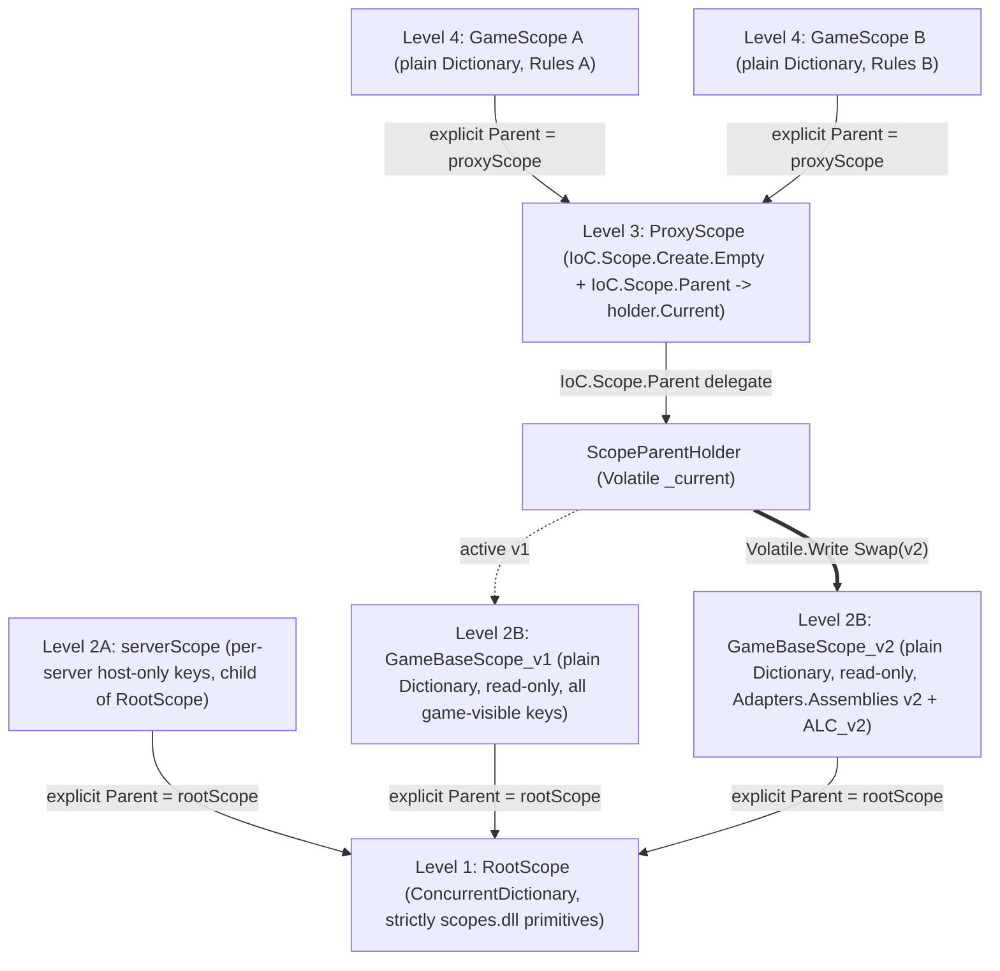

# Спецификация `02`: Декларативные JSON-правила, топологический `MacroCommand`, 4-уровневые скоупы и Lock-Free Hot-Reload

> **Статус:** Zero-Decision Delta Spec (Track A — поверх сведённой базы `origin/*` из Spec `01`)  
> **Связанные решения (`docs/DECISIONS.md`):** [`D-010`](../DECISIONS.md), [`D-011`](../DECISIONS.md), [`D-012`](../DECISIONS.md), [`D-017`](../DECISIONS.md), [`D-018`](../DECISIONS.md), [`D-019`](../DECISIONS.md), [`D-020`](../DECISIONS.md)  
> **Архитектура и дорожная карта:** [`docs/ARCHITECTURE.md`](../ARCHITECTURE.md), [`docs/ROADMAP.md`](../ROADMAP.md)  
> **Инварианты:** `INV-1`, `INV-2`, `INV-3`, `INV-4`, `INV-5`, `INV-6`, `INV-7`, `INV-8`, `INV-9`

---

## 1. Контекст, проблема, цели и границы

### 1.1. Проблема
На сведённой кодовой базе `origin/*` (121 `.cs` файл после Spec `01`) отсутствуют два обязательных контура сервера `SpaceBattle` (`ПЗ_1:13-21, 89`, `ПЗ_4:289-401`):

1. **Декларативные правила игры и топологическая сборка `MacroCommand` (`D-011`, `INV-4`):**
   - `CreateMacroCommandStrategy` уже умеет собирать `MacroCommand` по ключу `"Specs.<action>"`, но порядок шагов задаётся вручную в коде, без текстового описания правил, без топологической сортировки `"A before B"` и без детекции циклов.
   - В `RegisterIoCDependencyMacroCommand.cs` существует скрытый дефект стыковки: стратегия `CreateMacroCommandStrategy` передаёт в `"Commands.Macro"` список `List<ICommand>`, тогда как текущая регистрация приводит аргумент к массиву `(ICommand[])args[0]`, что вызывает `InvalidCastException` при реальном резолве.
   - Без декларативной загрузки правил на уровне `GameScope` невозможно запускать на одном сервере несколько партий одновременно с разными наборами правил (например, с проверкой/списанием топлива и без неё).

2. **4-уровневая иерархия скоупов (`depth = 4`, `INV-7`) и Lock-Free Hot-Reload плагинов (`D-012`):**
   - Существующие фабрики (`RegisterIoCDependencyGameCreate.cs`, `RegisterIoCDependencyTransferableGame.cs`) используют 0-аргументный `IoC.Scope.Create`, наследуя текущий скоуп и рискуя пробить лимит глубины `depth <= 4` (`INV-7`).
   - В `Common/scopes.dll` действует верифицированная ловушка Catch-22: повторный `IoC.Register("IoC.Scope.Parent", ...)` на непустом скоупе бросает `ArgumentException`, а вход в `IoC.Scope.Create.Empty` до записи `"IoC.Scope.Parent"` парализует любой `Ioc.Resolve` (`KeyNotFoundException: 'IoC.Scope.Parent'`).
   - В `origin/feature/adapter-codegen` (`GeneratedCodeCompiler.cs`, `RegisterIoCDependencyAdapter.cs`) используется глобальный `AppDomain.CurrentDomain.GetAssemblies()` и загрузка сгенерированных фабрик в `AssemblyLoadContext.Default`. При горячей подгрузке `.dll` плагинов в изолированный `AssemblyLoadContext` это вызывает три фатальных сбоя (блокер `B-03`): cross-ALC `TypeLoadException`, ошибки компиляции Roslyn `CS0433`/`CS0246` и падение с `InvalidOperationException: More than one [Dependency]`.

### 1.2. Измеримые цели (Goals)
1. Реализовать парсер и валидатор `game-rules.json` (`version`, `entities`, `actions` с `steps` и рёбрами `"A before B"`) на встроенном `System.Text.Json` (0 новых NuGet-пакетов), с детерминированной топологической сортировкой Кана внутри каждого действия.
2. Транслировать распарсенные правила в регистрации `IoC` внутри `GameScope` (`Specs.<action>`, `Macro.<action>`, `Game.Rules.Version`, `Game.Rules.Config` и стартовые сущности через существующий `SnapshotValueCodecs`), не изменяя `MacroCommand.cs` и `MacroCommandStrategy.cs` (`INV-3`).
3. Доказать сосуществование нескольких игр с разными `game-rules.json` одновременно в одном процессе.
4. Построить строгую 4-уровневую иерархию скоупов `RootScope → GameBaseScope_vN → ProxyScope → GameScope` (`depth == 4`, `INV-7`) с обязательной явной передачей родителя.
5. Реализовать `ProxyScopeFactory` (обход `scopes.dll` Catch-22) и `ScopeParentHolder` (`Volatile.Read/Write`) для атомарного переключения `Parent` в `ProxyScope` (0 правок `Game.cs`, 0 блокировок).
6. Реализовать явную команду `HotReloadGameBaseScopeCommand(string pluginsDir)` с загрузкой `*.dll` в новый `AssemblyLoadContext` (без `FileSystemWatcher`, без переопределения `Load` и без обёрток `Unload()`), scoped-каталогом `"Adapters.Assemblies"` на каждый `GameBaseScope_vN` и загрузкой сгенерированных фабрик адаптеров/команд в `ALC` целевого типа (`B-03`).
7. Обеспечить **100.00% line & branch** покрытие Coverlet и 0 нарушений `ooand-lint-gate.py` (`D-017`).

### 1.3. Не-цели (Non-Goals)
- Никакого универсального `bindings` mini-interpreter в `game-rules.json` (`D-011`).
- Никакого фонового потока `FileSystemWatcher` для автоматического отслеживания ФС (`D-012`).
- Никаких правок `Game.cs`, `MacroCommand.cs`, `MacroCommandStrategy.cs`, `InSeparateScopeCommand.cs` (`INV-3`, `INV-7`).
- Никаких `record`/`record struct` в продакшн-коде, никаких `switch` (операторов и выражений), никаких `-able` интерфейсов, никаких комментариев в `.cs` (`D-017`).
- Никаких сетевых эндпоинтов `/admin/hot-reload` (привязка HTTP-маршрута выполняется в `ServerBootstrap.cs` в Spec `03` через вызов ключа `"Scopes.HotReload"`).
- Никакой реализации бизнес-команд геймплея (`CheckFuelCommand`, `BurnFuelCommand`, `collision_matrix.csv` — зона Spec `05`).

### 1.4. Ключевые сценарии (`Given → When → Then`)
1. **Сборка `MacroCommand` по `"A before B"`:**
   - *Given* `game-rules.json` с действием `"Move"`, `steps: ["Commands.Move", "Commands.BurnFuel", "Commands.CheckFuel"]` и `order: ["Commands.CheckFuel before Commands.BurnFuel", "Commands.BurnFuel before Commands.Move"]`.
   - *When* правила распарсены и применены в `GameScope`, затем разрешена и выполнена `"Macro.Move"`.
   - *Then* команды выполняются строго в порядке `Commands.CheckFuel → Commands.BurnFuel → Commands.Move`; `"Game.Rules.Version"` и `"Game.Rules.Config"` доступны в `GameScope`.
2. **Сосуществование разных правил на одном сервере:**
   - *Given* единые `RootScope → GameBaseScope_v1 → ProxyScope` и две игры `GameScope_A` (правила с топливом `"v-fuel"`) и `GameScope_B` (правила без топлива `"v-classic"`).
   - *When* обе игры разрешают `"Macro.Move"` и `"Game.Rules.Version"` в своих скоупах.
   - *Then* `GameScope_A` выполняет `[CheckFuel, BurnFuel, Move]` и возвращает `"v-fuel"`, `GameScope_B` выполняет `[Move]` и возвращает `"v-classic"`, без взаимного влияния.
3. **Валидация на границе загрузки правил (отказ до любой `IoC.Register`):**
   - *Given* некорректный `game-rules.json` (цикл `"A before B"` + `"B before A"`, петля `"A before A"`, неизвестный шаг в ребре, дубликат имени действия в JSON, отсутствующее поле, `"null"`).
   - *When* вызывается `"Game.Rules.Parse"`.
   - *Then* выбрасывается детерминированное исключение (`ArgumentException` / `InvalidOperationException` / `JsonException`) с указанием имени действия/шага, а в `GameScope` не попадает ни одной частичной регистрации.
4. **Глубина скоупов строго `4` и защита от `scopes.dll` Catch-22:**
   - *Given* инициализированная иерархия через `RegisterIoCDependencyScopeHierarchy`.
   - *When* создаётся `GameScope` через `"Scopes.Game.Create"`.
   - *Then* обход цепочки `"IoC.Scope.Parent"` от `GameScope` до `RootScope` даёт ровно `4` узла (`GameScope → ProxyScope → GameBaseScope_v1 → RootScope`), причём ни одна операция не падает с `ArgumentException`/`KeyNotFoundException`.
5. **Lock-Free Hot-Reload `.dll` плагина:**
   - *Given* живая игра в `GameScope` на `GameBaseScope_v1` (с `Plugin_v1.dll`) и каталог плагинов с новой версией `Plugin_v2.dll` (обновляющей команду, новый `-ing` интерфейс и `[assembly: Dependency]`).
   - *When* другой поток вызывает `HotReloadGameBaseScopeCommand(pluginsDirV2)`.
   - *Then* `ProxyScope` атомарно переключается на `v2` через `Volatile.Write`, и игра без перезапуска и блокировок видит `v2` (новую команду, сгенерированный в `alc_v2` адаптер и обновлённый `[assembly: Dependency]`) без `TypeLoadException`, `CS0433` и ошибки дубля `[Dependency]`.
6. **Отказоустойчивость Hot-Reload:**
   - *Given* живой сервер на `GameBaseScope_v1` и каталог с повреждённым `.dll` или плагином, чей `Register*` бросает исключение.
   - *When* вызывается `HotReloadGameBaseScopeCommand`.
   - *Then* выбрасывается исключение, указатель `ScopeParentHolder` остаётся на `v1`, все игры продолжают работу без сбоя.

---

## 2. Архитектура и альтернативы

### 2.1. Декларативные JSON-правила и топологическая сборка `MacroCommand` (`D-011`, `INV-4`)

#### 2.1.1. Каноническая схема `game-rules.json`
Схема содержит 3 обязательных корневых поля (`version`, `entities`, `actions`) и 3 опциональных корневых поля (`templates`, `collisions`, `victory_target`) для декларативного описания новых типов сущностей, правил их столкновений и типа целевых объектов победы per-game (`D-019`). Формат свойств сущностей и шаблонов **полностью переиспользует** существующий формат `SnapshotValueCodecs` (`{ "type": "<Type.FullName>", "value": <JsonElement> }`) и декодируется через `GameSnapshotBuilder.ReadItem`. Строки `"type"` обязаны точно совпадать с ключами, зарегистрированными в `"Snapshot.Codecs"` (`"SpaceBattle.Lib.Vector"`, `"SpaceBattle.Lib.Angle"`, `"System.Int32"`, `"System.String"`, `"System.Boolean"` и кодеки загруженных плагинов). Стартовая сущность задаёт `"Speed"` + `"Angle"` (производный `Velocity` вычисляется через `[assembly: Dependency]` из Spec `01`) и идентификатор владельца `"OwnerId"`:

```json
{
  "version": "1.0.0",
  "victory_target": "Ship",
  "templates": {
    "Torpedo": {
      "TickAction": { "type": "System.String", "value": "Macro.ProjectileTick" },
      "IsAlive": { "type": "System.Boolean", "value": true }
    }
  },
  "collisions": {
    "Ship.Torpedo": "Commands.Collision.DestroyIfEnemy"
  },
  "entities": [
    {
      "id": 1,
      "properties": {
        "Position": { "type": "SpaceBattle.Lib.Vector", "value": [10, 20] },
        "Speed": { "type": "System.Int32", "value": 1 },
        "Angle": { "type": "SpaceBattle.Lib.Angle", "value": [0, 8] },
        "Fuel": { "type": "System.Int32", "value": 100 },
        "OwnerId": { "type": "System.String", "value": "player-1" }
      }
    }
  ],
  "actions": {
    "Move": {
      "steps": ["Commands.Move", "Commands.BurnFuel", "Commands.CheckFuel"],
      "order": [
        "Commands.CheckFuel before Commands.BurnFuel",
        "Commands.BurnFuel before Commands.Move"
      ]
    },
    "Rotate": {
      "steps": ["Commands.Rotate"]
    }
  }
}
```

#### 2.1.2. Правила граничной валидации (Boundary Validation)
Вся валидация выполняется строго на границе парсинга в `GameRulesParserBuilder` через `JsonDocument.Parse(json)` (без `JsonSerializer.Deserialize<Dictionary<...>>`, который молча перезаписывает дубликаты ключей JSON) и без единого `switch`:

| Условие нарушения | Точное исключение | Примечание |
| :--- | :--- | :--- |
| `json` равен `null`, пуст или состоит из пробелов | `ArgumentException` | `ArgumentException.ThrowIfNullOrWhiteSpace` |
| Синтаксически невалидный JSON (`"{bad"`) | `JsonException` | Из `JsonDocument.Parse` |
| Корень JSON не объект (`"null"`, `[]`, `123`, `"abc"`) | `ArgumentException` | Проверка `root.ValueKind != JsonValueKind.Object` |
| Отсутствует, не строка или пуст/пробелен `version` | `ArgumentException` | Обязательное непустое поле |
| Опциональный `victory_target` присутствует, но не строка или пуст/пробелен | `ArgumentException` | Если опущен — `"Ship"` по умолчанию в L2B |
| Опциональный `templates` присутствует, но не объект; дубликат/пустое имя шаблона; тело не объект; свойство не объект | `ArgumentException` | Свойства клонируются через `.Clone()` до `Dispose()`; если опущен — пустой словарь |
| Опциональный `collisions` присутствует, но не объект; ключ не соответствует `"<A>.<B>"` (2 непустые части через `.`); дубликат нормализованной пары (`"A.B"` / `"B.A"`); значение не строка/пустое | `ArgumentException` | Ключи нормализуются (`Ordinal`) в паре; если опущен — пустой словарь |
| Отсутствует или не массив `entities` | `ArgumentException` | Допускается пустой массив `[]` |
| Элемент `entities`: не объект, отсутствует/не `Int32` `id`, дубликат `id`, отсутствует/не объект `properties`, свойство не объект | `ArgumentException` | Все `JsonElement` клонируются через `.Clone()` до `Dispose()` `JsonDocument` |
| Отсутствует или не объект `actions` | `ArgumentException` | Допускается пустой объект `{}` |
| Дубликат имени действия в объекте `actions` | `ArgumentException` | Отлавливается явным обходом `actionsElement.EnumerateObject()` + `HashSet<string>` |
| Имя действия пусто/пробельно или тело действия не объект | `ArgumentException` | — |
| Отсутствует, не массив или пуст `steps`; элемент `steps` не строка/пробельный; дубликат шага в `steps` | `ArgumentException` | — |
| Поле `order` присутствует, но не массив или содержит не-строку/пробельный элемент | `ArgumentException` | Если поле `order` опущено — считается пустым списком ограничений |
| Строка в `order` не соответствует грамматике `"<A> before <B>"` (разделитель `" before "`, ровно 2 части) | `ArgumentException` | Отвергает `"A"`, `"A after B"`, `"A before B before C"` |
| `<A>` или `<B>` в ребре `order` отсутствует в `steps` данного действия | `ArgumentException` | Неизвестный шаг |
| Самопетля `<A> == <B>` (`"Commands.Move before Commands.Move"`) | `InvalidOperationException` | Детерминированное сообщение с именем действия и шага |
| Дубликат ребра (`"A before B"` указан дважды) | *(валидно, идемпотентно)* | Дедупликация через `HashSet<(int From, int To)>` — не завышает `inDegree` |
| Цикл в графе шагов действия (2+ узлов, например `A → B → C → A`) | `InvalidOperationException` | Сообщение содержит имя действия и имена зацикленных шагов |
| Кросс-экшн цикл (`Macro.A` → `Macro.B` → `Macro.A` или `A` → `Macro.A`) | `InvalidOperationException` | Проверка через `TopologicalOrderBuilder.Sort("actions", ...)` по шагам вида `"Macro.<Name>"` |

#### 2.1.3. Детерминированный алгоритм Кана (`TopologicalOrderBuilder`)
- Каждому шагу присваивается индекс объявления `0..N-1` в массиве `steps`.
- Уникальные рёбра хранятся в `HashSet<(int From, int To)>`, формируя списки смежности `List<int>[]` и массив полустепеней захода `int[] inDegree`.
- Множество готовых узлов (`inDegree[i] == 0`) хранится в `SortedSet<int>`: на каждом шаге извлекается `ready.Min` (наименьший индекс объявления в `steps`). Это гарантирует **100% детерминированный порядок** между разными процессами, запусками и ОС (устраняет `M-02`) при сложности $O((V + E) \log V)$.
- При уменьшении `inDegree[next]`: узел добавляется в `ready` только когда `inDegree[next] == 0` (проверяется обязательным diamond-DAG тестом: `A before C`, `B before C`).
- Если `ordered.Count != nodes.Count`, выбрасывается `InvalidOperationException` со списком всех узлов с `inDegree[i] > 0`.

#### 2.1.4. Трансляция в `IoC` внутри `GameScope`
`RegisterGameRulesCommand(GameRulesConfig config)` выполняется внутри `InSeparateScopeCommand(gameScope, ...)` и выполняет строго следующие регистрации в текущем `GameScope`:
1. `"Game.Rules.Version"` → `_ => config.Version`
2. `"Game.Rules.Config"` → `_ => config.RawJson`
3. Если `config.VictoryTarget != null`: `"Game.Victory.TargetType"` → `_ => config.VictoryTarget` (переопределяет L2B-дефолт `"Ship"` в `GameScope` для `MatchState`).
4. Для каждого действия `action` из `config.Actions`:
   - `"Specs." + action.Name` → `_ => action.OrderedSteps` (`IReadOnlyList<string>`, реализует `IEnumerable<string>`)
   - `"Macro." + action.Name` → `args => Ioc.Resolve<ICommand>("Commands.InTransaction", strategy.Resolve(args))`, где `strategy = new CreateMacroCommandStrategy(action.Name)` (существующий `CreateMacroCommandStrategy` **не изменяется**, `INV-3`). В L2B `GameBaseScope_vN` `"Commands.InTransaction"` по умолчанию регистрируется как pass-through (`args => (ICommand)args[0]`), а в L4 `GameScope` (Spec `04`) переопределяется на реальный `InTransactionCommand` (вложенные фреймы `GameTransactions` поддерживаются стеком за $O(1)$).
5. Если `config.Templates.Count > 0`:
   - Разрешает `SnapshotValueCodecs` (`"Snapshot.Codecs"`).
   - Для каждого шаблона `(templateName, templateProps)` регистрирует `"Game.Entity.Template." + templateName` → `_ => GameSnapshotBuilder.ReadItem(templateProps, codecs)` (свежая копия словаря на каждый вызов) и регистрирует `"Game.Entity.Template.Resolve"` `(string entityType)` → при совпадении `entityType` в `config.Templates` возвращает `GameSnapshotBuilder.ReadItem(props, codecs)`, иначе пустой `Dictionary<string, object>` (0 исключений `scopes.dll` при отсутствии шаблона).
6. Для каждого правила коллизии `(pairKey, handlerKey)` из `config.Collisions` (`pairKey` нормализован в `"<First>.<Second>"`):
   - Регистрирует в L4 `GameScope` `"Game.Collision.Handle." + pairKey` → `args => Ioc.Resolve<ICommand>(handlerKey, args)` (переопределяет L2B-обработчик для данной игры).
7. Если `config.Entities.Count > 0`:
   - Разрешает `IWritableGameObjectRepository` (`"Game.Repository.Writable"`) и `SnapshotValueCodecs` (`"Snapshot.Codecs"`).
   - Для каждой сущности `entity` декодирует свойства через `GameSnapshotBuilder.ReadItem(entity.Properties, codecs)`, пропускает через `Ioc.Resolve<IDictionary<string, object>>("Game.Item.Create", rawItem)` и записывает в `repository.Set(entity.Id, item)`.
   - Ключ `"Game.Item.Create"` по умолчанию регистрируется в `GameBaseScope` командой `RegisterIoCDependencyGameRules` как фабрика копии словаря `args => new Dictionary<string, object>((IDictionary<string, object>)args[0])`; в Spec `04` транзакционные игры переопределяют его в `GameScope` на обёртку `TransactionalGameItem` без правок кода правил (`INV-3`, `D-015`).
   - По завершении загрузки сущностей вызывает `Ioc.Resolve<ICommand>("Game.State.Reindex", maxId + 1).Execute()`, где `maxId` — максимальный `entity.Id` (в L2B по умолчанию no-op `"Commands.Empty"`, в L4 Spec `05` — индексация в `SectorGrid`, сдвиг `EntityIdGenerator` и пополнение `MatchState.Players`).
8. Для совместимости с `RegisterIoCDependencyTransferableGame` (`"Game.Rules.<name>"`) команда `RegisterIoCDependencyGameRules` также предоставляет ключ `"Game.Rules.RegisterNamed"` (`(string ruleName, string rulesJson)` → регистрирует `"Game.Rules." + ruleName` в текущем `GameBaseScope` как команду `RegisterGameRulesCommand` для заранее распарсенного и провалидированного `GameRulesConfig`).

---

### 2.2. 4-уровневая иерархия скоупов (`depth = 4`, `INV-7`) и Lock-Free `ProxyScope` Hot-Reload (`D-012`)

#### 2.2.1. Диаграмма скоупов и жизненный цикл переключения



#### 2.2.2. Решение ловушки `Common/scopes.dll` Catch-22 (`ProxyScopeFactory`)
В `Common/scopes.dll` ([`docs/ARCHITECTURE.md §5.1`](../ARCHITECTURE.md)):
- `IoC.Scope.Create` уже вставляет `"IoC.Scope.Parent"` в новый `Dictionary`, поэтому повторный `IoC.Register("IoC.Scope.Parent", ...)` бросает `ArgumentException`.
- `IoC.Scope.Create.Empty` создаёт пустой `Dictionary`, но при установке его как `IoC.Scope.Current` любой `Ioc.Resolve` (включая `IoC.Register`) бросает `KeyNotFoundException: 'IoC.Scope.Parent'`.

**Единственно корректная конструкция (`ProxyScopeFactory.cs`, infra-файл с маркером `Factory`):**
1. Вызвать `var proxyScope = Ioc.Resolve<object>("IoC.Scope.Create.Empty");`
2. Не переключаясь в `proxyScope`, привести к `IDictionary<string, Func<object[], object>>` и записать ровно один ключ:
   `dictionary["IoC.Scope.Parent"] = _ => holder.Current;`
3. Вернуть готовый `proxyScope`. После этого `proxyScope` никогда не мутируется и может безопасно выступать родителем для любого числа `GameScope` на всех потоках `ServerThread`.

#### 2.2.3. Разделение `RootScope` / `L2A serverScope` / `L2B GameBaseScope_vN` и строгая глубина `4` (`INV-7`)
- **Строгая чистота `RootScope` (Level 1):** `RootScope` хранит **исключительно примитивы `Common/scopes.dll`** — в него никогда не регистрируются per-server зависимости. Это гарантирует, что два экземпляра `SpaceBattle.Server` (и параллельные xUnit-тесты) в одном процессе никогда не сталкиваются с ловушкой #1 `scopes.dll` (`ArgumentException` при повторном `IoC.Register`).
- **Две ветви уровня 2 (обе — прямые дочерние скоупы `rootScope`):**
  - **Level 2A — `serverScope`** (`Ioc.Resolve<object>("IoC.Scope.Create", rootScope)`): per-server скоуп хоста, в котором выполняется `RegisterIoCDependencyScopeHierarchy(rootScope, baseInitializer)` и регистрируются **только host-only ключи**, разрешаемые синхронно на старте и в административных командах (`"Server.Scope.*"`, `"Scopes.*"`, `"Game.Create.Scoped"`, а в Spec `03`/`04` — `"Server.Router"`, `"Server.Admin.*"`, `"Server.Thread.*"`, `"Game.Transfer.Remote"`, `"Server.Snapshot.*"`).
  - **Level 2B — `GameBaseScope_vN`** (`Ioc.Resolve<object>("IoC.Scope.Create", rootScope)`): общий игровой скоуп, подключаемый к играм через `ProxyScope`. Команда `baseInitializer` обязана регистрировать **все ключи, разрешаемые во время исполнения игр** (из Spec `02`/`03`/`04`/`05`: `RegisterIoCDependencyGameRules`, `RegisterIoCDependencyMacroCommand`, `"Snapshot.Codecs"`, `"Exception.Handle"`, `"Server.Connections"`, `"Game.Message.*"`, `"Commands.InterpretMessage"`, `"Game.Transfer.Quarantine*"`, `"Game.Collision.*"`, доменные команды и адаптеры) внутри каждого нового `GameBaseScope_vN`.
- **Запрет 0-аргументного `IoC.Scope.Create`:** все фабрики (`GameBaseScopeBuilder`, `"Scopes.Game.Create"`, `"Game.Create.Scoped"`) обязаны передавать родителя явно:
  - `GameBaseScope_vN` всегда создаётся через `Ioc.Resolve<object>("IoC.Scope.Create", rootScope)` (**уровень 2B**).
  - `ProxyScope` создаётся через `ProxyScopeFactory.Create(holder)` (**уровень 3**).
  - `GameScope` всегда создаётся через `Ioc.Resolve<object>("IoC.Scope.Create", proxyScope)` (**уровень 4**).
  - Итоговая цепочка поиска любой игры — `GameScope → ProxyScope → GameBaseScope_vN → RootScope` — имеет **строгую глубину `4` (`INV-7`)** как в продакшне, так и во всех параллельных и 2-серверных xUnit-тестах.

#### 2.2.4. Lock-Free `ScopeParentHolder`
- **`ScopeParentHolder`** (plain `sealed class`, 0 `new`, 0 блокировок, 0 аллокаций на горячем пути):
  - `private object _current;` — обновляется только через `Volatile.Write(ref _current, nextBaseScope)`.
  - `public object Current => Volatile.Read(ref _current);`
  - `public void Swap(object nextBaseScope)` — проверяет `ArgumentNullException.ThrowIfNull(nextBaseScope)` и публикует `Volatile.Write(ref _current, nextBaseScope);`.
  - `Game.cs` и `InSeparateScopeCommand.cs` остаются **полностью нетронутыми** (`INV-3`, `INV-7`).
  - Строгий инвариант иммутабельности: после вызова `holder.Swap(vN)` в `GameBaseScope_vN` запрещён любой `IoC.Register` — `Dictionary` работает исключительно в режиме конкурентного чтения (безопасно в .NET).

#### 2.2.5. Явная загрузка `.dll` плагинов и устранение `B-03` (`Adapters.Assemblies` + Target-ALC)
1. **`ScopedAssemblyCatalog` & `ScopedAssemblyCatalogFactory`:**
   - Заменяет глобальный `AppDomain.CurrentDomain.GetAssemblies()` (который протекает между версиями плагинов в разных `ALC`!).
   - Базовый набор всегда строится через `ScopedAssemblyCatalogFactory.FromAssemblies(AssemblyLoadContext.Default.Assemblies)` (исключая любые плагиновые `ALC`; шов `FromAssemblies(IEnumerable<Assembly>)` обеспечивает детерминированное 100% покрытие ветки `a.Location.Length > 0`).
   - Для плагинов текущей версии `vN` в каталог добавляются:
     - сами объекты `Assembly` в `Assemblies` (для поиска `[assembly: Dependency]` в `RegisterIoCDependencyAdapter`);
     - `MetadataReference.CreateFromImage(peBytes)` в `MetadataReferences` (решает `CS0246` при `assembly.Location == ""` после `LoadFromStream` и исключает `CS0433` между `Plugin_v1` и `Plugin_v2`).
   - Каталог регистрируется в каждом `GameBaseScope_vN` под ключом **`"Adapters.Assemblies"`**.
2. **`GeneratedCodeCompiler` (точечная доработка, 100% обратная совместимость):**
   - Добавляется перегрузка `public T Compile<T>(string source, AssemblyLoadContext targetLoadContext, IEnumerable<MetadataReference> references)`.
   - Существующий метод `public T Compile<T>(string source)` делегирует в новую перегрузку с `AssemblyLoadContext.Default` и `ScopedAssemblyCatalogFactory.CreateDefault().MetadataReferences` (все существующие тесты Fork A продолжают проходить без правок).
   - `RegisterIoCDependencyAdapterFactory` и `RegisterIoCDependencyCommandFactory` принимают `ScopedAssemblyCatalog` (с конструктором по умолчанию `ScopedAssemblyCatalogFactory.CreateDefault()`), регистрируют `"Adapters.Assemblies"` (в `RegisterIoCDependencyAdapterFactory`) и передают в компилятор `AssemblyLoadContext.GetLoadContext(type.Assembly)!` и `catalog.MetadataReferences`.
   - Кеш `ConcurrentDictionary<Type, IAdapterFactory>` и `ConcurrentDictionary<Type, ICommandFactory>` живёт **локально внутри каждого `GameBaseScope_vN`**.
3. **`PluginLoaderFactory` (infra-файл `Factory` — единственное новое место с `new AssemblyLoadContext` и `Activator.CreateInstance`):**
   - Контракт `Load(string pluginsDirectory) → PluginBatch`:
     - Проверяет `ArgumentException.ThrowIfNullOrWhiteSpace(pluginsDirectory)` и `Directory.Exists(pluginsDirectory)` (`DirectoryNotFoundException`).
     - Создаёт `new AssemblyLoadContext("SpaceBattle.Plugins." + Guid.NewGuid().ToString("N"))` **без переопределения `Load`** — общие контракты (`core.dll`, `scopes.dll`, `SpaceBattle.Lib.dll`) автоматически разрешаются из `AssemblyLoadContext.Default` (единая идентичность типов, 0 мёртвых веток `AssemblyDependencyResolver`).
     - Перебирает `*.dll` в `pluginsDirectory` в детерминированном лексикографическом порядке (`StringComparer.Ordinal`).
     - Читает байты через `File.ReadAllBytes(dllPath)` (не блокирует `.dll` файл на диске!), загружает через `alc.LoadFromStream(ms)`.
     - Ищет в загруженной сборке регистраторы по точному предикату:
       `type.IsClass && !type.IsAbstract && typeof(ICommand).IsAssignableFrom(type) && type.Name.StartsWith("Register", StringComparison.Ordinal) && type.GetConstructor(Type.EmptyTypes) != null`,
       сортирует найденные типы по `type.FullName` (`StringComparer.Ordinal`) и инстанцирует через `(ICommand)Activator.CreateInstance(type)!`.
     - Собирает `ScopedAssemblyCatalogFactory.CreateWithPlugins(pluginAssemblies, pluginImages)` и возвращает `PluginBatch(catalog, registrationCommands)`.
4. **`HotReloadGameBaseScopeCommand(string pluginsDirectory) : ICommand`:**
   - Содержит **0 вызовов `new`**, **0 `Activator.CreateInstance`**, **0 `IDictionary`**, **0 `FileSystemWatcher`**.
   - Шаги `Execute()` (вызывается в контексте `serverScope` L2A):
     1. Разрешает `"Server.Scope.Root"`, `"Server.Scope.Holder"`, `"Scopes.Base.Initializer"`.
     2. Загружает плагины: `var batch = Ioc.Resolve<PluginBatch>("Scopes.Plugins.Load", _pluginsDirectory);`.
     3. Строит `var nextBaseScope = Ioc.Resolve<object>("Scopes.Base.Build", rootScope, baseInitializer, batch.Catalog, batch.RegistrationCommands);`.
     4. При успехе вызывает `holder.Swap(nextBaseScope);` — атомарный `Volatile.Write` переводит все игры на `v(N+1)`. При любом исключении на шагах 2–3 `holder.Swap` не вызывается, и сервер остаётся на `vN`.
   - **Контракт `GameBaseScopeBuilder.Build(rootScope, baseInitializer, catalog, registrationCommands)`:**
     - Создаёт `nextBaseScope = Ioc.Resolve<object>("IoC.Scope.Create", rootScope)` (без создания фиктивного `AssemblyLoadContext` на начальной загрузке!).
     - Внутри `InSeparateScopeCommand(nextBaseScope, ...)` последовательно выполняет:
       1. `new RegisterIoCDependencyAdapterFactory(catalog).Execute()` (регистрирует `"Adapters.Template.*"`, `"Adapters.Assemblies"`, `"Adapters.Factory"`).
       2. `new RegisterIoCDependencyCommandFactory(catalog).Execute()` (регистрирует `"Commands.Factory"`).
       3. `baseInitializer.Execute()` (все game-visible ключи из Spec `02`/`03`/`04`/`05`: общие игровые команды, `RegisterIoCDependencyMacroCommand`, `RegisterIoCDependencyGameRules`, `RegisterIoCDependencySnapshotCodecs` — **обязательно создаёт новый изолированный экземпляр `SnapshotValueCodecs` для каждого `GameBaseScope_vN`**, `"Exception.Handle"`, `"Server.Connections"`, `"Game.Message.*"`, `"Commands.InterpretMessage"`, `"Game.Transfer.Quarantine*"`, `"Game.Collision.*"` — **не должен** повторно вызывать `RegisterIoCDependencyAdapterFactory`/`CommandFactory`).
       4. **Переопределение ключей плагинами (`D-020`, обход `scopes.dll` Trap #1 при `depth == 4`):** если `registrationCommands.Count > 0`, на время выполнения регистраторов плагинов в ещё не опубликованный однопоточный словарь `nextBaseScope` временно записывается `dict["IoC.Register"] = args => new DelegatingCommand(() => dict[(string)args[0]] = (Func<object[], object>)args[1])`, выполняются все `cmd.Execute()` из `registrationCommands` (плагин может добавлять новые ключи и переопределять любые встроенные L2B-ключи вроде `"Commands.CheckGameOver"` или `"Game.Collision.Check"` стандартным `IoC.Register`), после чего в `finally` выполняется `dict.Remove("IoC.Register")` до возврата и публикации `nextBaseScope`.
     - Возвращает готовый иммутабельный `nextBaseScope`.

#### 2.2.6. Реестр всех `IoC`-ключей спецификации `02`

> **Level 1 (`RootScope`)** содержит строго примитивы `Common/scopes.dll` — ни одна зависимость сервера в `RootScope` не регистрируется.

| Ключ `IoC` | Уровень скоупа | Аргументы `args` | Возвращаемый тип | Кто регистрирует |
| :--- | :---: | :--- | :--- | :--- |
| `"Server.Scope.Root"` | 2A (`serverScope`) | — | `object` (`RootScope`) | `RegisterIoCDependencyScopeHierarchy` |
| `"Server.Scope.Holder"` | 2A (`serverScope`) | — | `ScopeParentHolder` | `RegisterIoCDependencyScopeHierarchy` |
| `"Server.Scope.Proxy"` | 2A (`serverScope`) | — | `object` (`ProxyScope`) | `RegisterIoCDependencyScopeHierarchy` |
| `"Scopes.Base.Initializer"` | 2A (`serverScope`) | — | `ICommand` | `RegisterIoCDependencyScopeHierarchy` |
| `"Scopes.Plugins.Load"` | 2A (`serverScope`) | `(string pluginsDir)` | `PluginBatch` | `RegisterIoCDependencyScopeHierarchy` |
| `"Scopes.Base.Build"` | 2A (`serverScope`) | `(object rootScope, ICommand baseInit, ScopedAssemblyCatalog catalog, IReadOnlyList<ICommand> regCommands)` | `object` (`GameBaseScope_vN`) | `RegisterIoCDependencyScopeHierarchy` |
| `"Scopes.Game.Create"` | 2A (`serverScope`) | — | `object` (child of `proxyScope`) | `RegisterIoCDependencyScopeHierarchy` |
| `"Scopes.HotReload"` | 2A (`serverScope`) | `(string pluginsDir)` | `ICommand` (`HotReloadGameBaseScopeCommand`) | `RegisterIoCDependencyScopeHierarchy` |
| `"Game.Create.Scoped"` | 2A (`serverScope`) | `(ICommand innerCommand, ICommand gameInitializer)` | `ICommand` (`InSeparateScopeCommand`) | `RegisterIoCDependencyScopeHierarchy` |
| `"Adapters.Assemblies"` | 2B (`GameBaseScope_vN`) | — | `ScopedAssemblyCatalog` | `RegisterIoCDependencyAdapterFactory` |
| `"Game.Rules.Parse"` | 2B (`GameBaseScope_vN`) | `(string rulesJson)` | `GameRulesConfig` | `RegisterIoCDependencyGameRules` |
| `"Game.Rules.Apply"` | 2B (`GameBaseScope_vN`) | `(GameRulesConfig config)` | `ICommand` (`RegisterGameRulesCommand`) | `RegisterIoCDependencyGameRules` |
| `"Game.Rules.RegisterNamed"` | 2B (`GameBaseScope_vN`) | `(string ruleName, string rulesJson)` | `ICommand` | `RegisterIoCDependencyGameRules` |
| `"Game.Rules.<name>"` | 2B (`GameBaseScope_vN`) | — | `ICommand` (`RegisterGameRulesCommand`) | Через `"Game.Rules.RegisterNamed"` |
| `"Game.Item.Create"` | 2B (`GameBaseScope_vN`, переопределяется в 4) | `(IDictionary<string, object> properties)` | `IDictionary<string, object>` | `RegisterIoCDependencyGameRules` |
| `"Game.Entity.Template.Resolve"` | 2B (`GameBaseScope_vN`, переопределяется в 4) | `(string entityType)` | `IDictionary<string, object>` | `RegisterIoCDependencyGameRules` / `RegisterGameRulesCommand` |
| `"Game.Entity.Template.<type>"` | 4 (`GameScope`) | — | `IDictionary<string, object>` | `RegisterGameRulesCommand` |
| `"Game.Victory.TargetType"` | 2B / 4 (`GameScope` override) | — | `string` (`"Ship"` по умолчанию) | `RegisterIoCDependencyGameRules` / `RegisterGameRulesCommand` |
| `"Game.Collision.Handle.<A>.<B>"` | 2B / 4 (`GameScope` override) | `(int idA, int idB)` | `ICommand` | `RegisterGameRulesCommand` (секция `collisions`) |
| `"Commands.InTransaction"` | 2B (`GameBaseScope_vN`, переопределяется в 4) | `(ICommand inner)` | `ICommand` (pass-through по умолчанию) | `RegisterIoCDependencyGameRules` |
| `"Game.State.Reindex"` | 2B (`GameBaseScope_vN`, переопределяется в 4) | `(int minNextId)` | `ICommand` (no-op по умолчанию) | `RegisterIoCDependencyGameRules` |
| `"IoC.Scope.Parent"` | 3 (`ProxyScope`) | — | `object` (`holder.Current`) | `ProxyScopeFactory` |
| `"Game.Rules.Version"` | 4 (`GameScope`) | — | `string` | `RegisterGameRulesCommand` |
| `"Game.Rules.Config"` | 4 (`GameScope`) | — | `string` (исходный JSON) | `RegisterGameRulesCommand` |
| `"Specs.<action>"` | 4 (`GameScope`) | — | `IEnumerable<string>` (`IReadOnlyList<string>`) | `RegisterGameRulesCommand` |
| `"Macro.<action>"` | 4 (`GameScope`) | `(params object[] args)` | `ICommand` (`MacroCommand`) | `RegisterGameRulesCommand` |

*(Примечание: `"Game.Create.Scoped"` — чистый хелпер создания 4-уровневого `GameScope` + `InSeparateScopeCommand` без привязки к `ServerThread` и без блокирующего `thread.Receive(...)`; в Spec `04` `"Game.Create.Transferable"` и `"Game.Restore"` используют `"Scopes.Game.Create"` или `"Game.Create.Scoped"` напрямую.)*

---

### 2.3. Рассмотренные альтернативы (Alternatives Considered)

1. **Формат правил (`D-011`):**
   - *Отклонено:* собственный строковый DSL (лишний лексер, сложнее 100% branch coverage и сложнее встраивать в `GameSnapshot`) и YAML через `YamlDotNet` (новый внешний NuGet-пакет).
   - *Отклонено:* универсальная секция `bindings` (мини-интерпретатор выражений раздувает ветки и дублирует IoC-регистрацию).
   - *Выбрано:* структурированный `game-rules.json` на `System.Text.Json` + переиспользование `SnapshotValueCodecs` и `CreateMacroCommandStrategy`.
2. **Обновление скоупов при Hot-Reload (`D-012`):**
   - *Отклонено:* последовательное обновление родителя каждой игры (split-brain между играми, запрещено в `ПЗ_4:313-333`).
   - *Отклонено:* `ReaderWriterLockSlim` вокруг `GameBaseScope` (нарушает lock-free контракт `ПЗ_4:269-281, 349`).
   - *Выбрано:* `ProxyScopeFactory` + `ScopeParentHolder` (`Volatile.Read/Write` на единой ссылке `Parent` в `ProxyScope`, `ПЗ_4:321-345`), глубина строго 4.
3. **Механизм запуска Hot-Reload и загрузка плагинов (`D-012`, `D-017`):**
   - *Отклонено:* `FileSystemWatcher` (нестабильные события ОС, непокрытые ветки буфера ошибок) и переопределение `AssemblyLoadContext.Load` с `AssemblyDependencyResolver` (мёртвые ветки резолва сателлитных сборок).
   - *Выбрано:* явная команда `HotReloadGameBaseScopeCommand(string pluginsDir)` + простой `AssemblyLoadContext` с `LoadFromStream` без переопределения `Load`, тестируемая временными `.dll`, скомпилированными через Roslyn прямо в xUnit.

---

### 2.4. Риски, ограничения и матрица соответствия `ooand-lint-gate.py` (`D-017`)

- **Конкурентный вызов двух `HotReloadGameBaseScopeCommand`:** каждый вызов строит собственный изолированный `GameBaseScope_vN` и атомарно записывает указатель через `Volatile.Write` — повреждения `Dictionary` невозможны; сериализация административных вызовов выполняется на уровне `/admin/hot-reload` (Spec `03`).
- **Долгоживущий `JsonElement` после `JsonDocument.Dispose()`:** устраняется обязательным вызовом `.Clone()` при сохранении каждого `JsonElement` в `GameRulesParserBuilder`.
- **Отсутствие коллизий с треками B и C (`docs/ROADMAP.md §2`):** все новые файлы лежат исключительно в `SpaceBattle.Lib/{Rules,Scopes}/`, а 5 модифицируемых файлов — только в `SpaceBattle.Lib/Adapters/` и `RegisterIoCDependencyMacroCommand.cs` (0 пересечений с `Server/`, `Transfer/`, `Transactions/`, `SpaceBattle.Server/`).
- **Проверка гейта `ooand-lint-gate.py` по каждому файлу:**
  - Все файлы с `new` вне `ALLOWED_NEW_TYPES` содержат маркеры `INFRA_FILE_MARKERS` (`Builder`, `Factory`, `Register`, `Compiler`).
  - `Activator.CreateInstance` используется исключительно в `PluginLoaderFactory.cs` и `GeneratedCodeCompiler.cs`.
  - В не-infra `*Command.cs` (`HotReloadGameBaseScopeCommand.cs`) отсутствуют `IDictionary<string, object>`, `new` и `Activator.CreateInstance`.
  - В продакшн-коде **0 `record`**, **0 `switch`**, **0 `-able` интерфейсов**, **0 комментариев**, **0 правок доменных команд** (0 `OCP-WARN`).

---

## Detailed Implementation Plan

> Все пути указаны относительно корня канонического клона (`SpaceBattle/SpaceBattle.sln`). Пространство имён для всех классов `SpaceBattle.Lib` — `SpaceBattle.Lib` (единообразно с `origin/*`).

### 3.1. Новые файлы (`Create`) в `SpaceBattle/SpaceBattle.Lib/`

#### Модуль `SpaceBattle/SpaceBattle.Lib/Rules/`

1. **`SpaceBattle/SpaceBattle.Lib/Rules/GameRuleEntity.cs`** (`Create`, plain `sealed class`, 0 `new`)
   - Свойства (только `get`):
     - `public int Id { get; }`
     - `public IReadOnlyDictionary<string, Dictionary<string, JsonElement>> Properties { get; }`
   - Конструктор: `public GameRuleEntity(int id, IReadOnlyDictionary<string, Dictionary<string, JsonElement>> properties)` — проверяет `ArgumentNullException.ThrowIfNull(properties)`.

2. **`SpaceBattle/SpaceBattle.Lib/Rules/GameRuleAction.cs`** (`Create`, plain `sealed class`, 0 `new`)
   - Свойства (только `get`):
     - `public string Name { get; }`
     - `public IReadOnlyList<string> OrderedSteps { get; }`
   - Конструктор: `public GameRuleAction(string name, IReadOnlyList<string> orderedSteps)` — проверяет `ArgumentException.ThrowIfNullOrWhiteSpace(name)` и `ArgumentNullException.ThrowIfNull(orderedSteps)`.

3. **`SpaceBattle/SpaceBattle.Lib/Rules/GameRulesConfig.cs`** (`Create`, plain `sealed class`, 0 `new`)
   - Свойства (только `get`):
     - `public string Version { get; }`
     - `public string RawJson { get; }`
     - `public string? VictoryTarget { get; }`
     - `public IReadOnlyDictionary<string, IReadOnlyDictionary<string, Dictionary<string, JsonElement>>> Templates { get; }`
     - `public IReadOnlyDictionary<string, string> Collisions { get; }`
     - `public IReadOnlyList<GameRuleEntity> Entities { get; }`
     - `public IReadOnlyList<GameRuleAction> Actions { get; }`
   - Конструктор: `public GameRulesConfig(string version, string rawJson, IReadOnlyList<GameRuleEntity> entities, IReadOnlyList<GameRuleAction> actions, string? victoryTarget = null, IReadOnlyDictionary<string, IReadOnlyDictionary<string, Dictionary<string, JsonElement>>>? templates = null, IReadOnlyDictionary<string, string>? collisions = null)` — валидирует обязательные аргументы (`ThrowIfNullOrWhiteSpace` для строк, `ThrowIfNull` для списков; пустые словари по умолчанию для `templates` и `collisions`).

4. **`SpaceBattle/SpaceBattle.Lib/Rules/TopologicalOrderBuilder.cs`** (`Create`, infra `Builder`, 0 `switch`)
   - `public sealed class TopologicalOrderBuilder`
   - Метод `public IReadOnlyList<string> Sort(string graphName, IReadOnlyList<string> nodes, IReadOnlyList<(string From, string To)> edges)`:
     - Проверяет `graphName`, `nodes`, `edges` на `null`/пустоту (для `nodes` проверяет уникальность имён и непустоту).
     - Строит `Dictionary<string, int> indexByName`, дедуплицирует рёбра через `HashSet<(int From, int To)>`.
     - Для каждого ребра `(from, to)`: если `from` или `to` отсутствует в `indexByName` → `ArgumentException`; если `fromIndex == toIndex` → `InvalidOperationException` (self-loop).
     - Инициализирует `SortedSet<int> ready` всеми узлами с `inDegree[i] == 0`.
     - Цикл Кана: извлекает `current = ready.Min`, удаляет из `ready`, добавляет `nodes[current]` в результат, для каждого `next` уменьшает `inDegree[next]` и при `inDegree[next] == 0` добавляет `next` в `ready`.
     - Если `result.Count != nodes.Count` → `InvalidOperationException` с перечислением имени графа и узлов с `inDegree[i] > 0`.
   - Метод `public IReadOnlyList<string> SortActionSteps(string actionName, IReadOnlyList<string> steps, IReadOnlyList<string> orderConstraints)`:
     - Парсит каждую строку ограничения через `constraint.Split(" before ", StringSplitOptions.None)`: если `parts.Length != 2` → `ArgumentException`.
     - Делегирует в `Sort(actionName, steps, parsedEdges)`.

5. **`SpaceBattle/SpaceBattle.Lib/Rules/GameRulesParserBuilder.cs`** (`Create`, infra `Builder`, 0 `switch`)
   - `public sealed class GameRulesParserBuilder`
   - Конструктор: `public GameRulesParserBuilder(TopologicalOrderBuilder sorter)` (проверяет `ArgumentNullException.ThrowIfNull(sorter)`).
   - Метод `public GameRulesConfig Parse(string json)`:
     - Проверяет `ArgumentException.ThrowIfNullOrWhiteSpace(json)`.
     - Выполняет `using var document = JsonDocument.Parse(json);`.
     - Проверяет `root.ValueKind == JsonValueKind.Object`, извлекает и валидирует `version`, опциональные `victory_target`, `templates`, `collisions`, обязательные `entities`, `actions` строго по таблице §2.1.2 (клонируя все `JsonElement` через `.Clone()`, нормализуя пары `collisions` через `string.CompareOrdinal`, отлавливая дубликаты `entity.id`, дубликаты ключей в `templates`/`collisions`/`actions` через `EnumerateObject()` и дубликаты шагов).
     - Для каждого действия сортирует `steps` через `_sorter.SortActionSteps(actionName, steps, orderConstraints)`.
     - Проверяет кросс-экшн граф зависимостей: для каждого шага вида `"Macro.<Target>"`, если `<Target>` является именем действия из `actions`, добавляет ребро `(actionName, target)` и вызывает `_sorter.Sort("actions", actionNames, crossEdges)` (отвергая циклы `Macro.A -> Macro.B -> Macro.A`).
     - Возвращает `new GameRulesConfig(version, json, entities, actions, victoryTarget, templates, collisions)`.

6. **`SpaceBattle/SpaceBattle.Lib/Rules/RegisterGameRulesCommand.cs`** (`Create`, infra `Register`, `: ICommand`)
   - Конструктор: `public RegisterGameRulesCommand(GameRulesConfig config)` (`ArgumentNullException.ThrowIfNull(config)`).
   - Метод `public void Execute()`:
     - Регистрирует `"Game.Rules.Version"` → `_ => _config.Version`.
     - Регистрирует `"Game.Rules.Config"` → `_ => _config.RawJson`.
     - Если `_config.VictoryTarget != null`: регистрирует `"Game.Victory.TargetType"` → `_ => _config.VictoryTarget`.
     - Для каждого `action` из `_config.Actions`:
       - Регистрирует `"Specs." + action.Name` → `_ => action.OrderedSteps`.
       - Создаёт `var strategy = new CreateMacroCommandStrategy(action.Name);` и регистрирует `"Macro." + action.Name` → `args => Ioc.Resolve<ICommand>("Commands.InTransaction", strategy.Resolve(args))`.
     - Если `_config.Templates.Count > 0`:
       - Разрешает `SnapshotValueCodecs` (`"Snapshot.Codecs"`), регистрирует `"Game.Entity.Template." + name` и `"Game.Entity.Template.Resolve"` (возвращает свежую копию по имени или пустой словарь при отсутствии).
     - Для каждой пары `(pairKey, handlerKey)` в `_config.Collisions`:
       - Регистрирует `"Game.Collision.Handle." + pairKey` → `args => Ioc.Resolve<ICommand>(handlerKey, args)`.
     - Если `_config.Entities.Count > 0`:
       - Разрешает `IWritableGameObjectRepository` (`"Game.Repository.Writable"`) и `SnapshotValueCodecs` (`"Snapshot.Codecs"`).
       - Для каждой `entity` в `_config.Entities`: вызывает `var raw = GameSnapshotBuilder.ReadItem(entity.Properties, codecs);`, оборачивает через `var item = Ioc.Resolve<IDictionary<string, object>>("Game.Item.Create", raw);`, сохраняет `repository.Set(entity.Id, item);`, отслеживая `maxId`.
       - Вызывает `Ioc.Resolve<ICommand>("Game.State.Reindex", maxId + 1).Execute()`.

7. **`SpaceBattle/SpaceBattle.Lib/Rules/RegisterIoCDependencyGameRules.cs`** (`Create`, infra `Register`, `: ICommand`)
   - Метод `public void Execute()`:
     - Создаёт `var sorter = new TopologicalOrderBuilder();` и `var parser = new GameRulesParserBuilder(sorter);`.
     - Регистрирует `"Game.Rules.Parse"` → `args => parser.Parse((string)args[0])`.
     - Регистрирует `"Game.Rules.Apply"` → `args => new RegisterGameRulesCommand((GameRulesConfig)args[0])`.
     - Регистрирует `"Game.Rules.RegisterNamed"` → `args =>` возвращает `ICommand` (`DelegatingCommand`), который парсит `(string)args[1]` через `parser.Parse(...)` и регистрирует `"Game.Rules." + (string)args[0]` → `_ => new RegisterGameRulesCommand(parsed)` в текущем скоупе.
     - Регистрирует `"Game.Item.Create"` → `args => new Dictionary<string, object>((IDictionary<string, object>)args[0])`.
     - Регистрирует дефолтные (переопределяемые в L4) `"Game.Entity.Template.Resolve"` → `_ => new Dictionary<string, object>()`, `"Game.Victory.TargetType"` → `_ => "Ship"`, `"Commands.InTransaction"` → `args => (ICommand)args[0]` и `"Game.State.Reindex"` → `_ => Ioc.Resolve<ICommand>("Commands.Empty")`.

---

#### Модуль `SpaceBattle/SpaceBattle.Lib/Scopes/`

8. **`SpaceBattle/SpaceBattle.Lib/Scopes/ScopeParentHolder.cs`** (`Create`, plain `sealed class`, 0 `new`)
   - Поле:
     - `private object _current;`
   - Конструктор: `public ScopeParentHolder(object initialBaseScope)` (`ArgumentNullException.ThrowIfNull`, `Volatile.Write(ref _current, initialBaseScope)`).
   - Члены:
     - `public object Current => Volatile.Read(ref _current);`
     - `public void Swap(object nextBaseScope)` (`ArgumentNullException.ThrowIfNull(nextBaseScope)`, `Volatile.Write(ref _current, nextBaseScope)`).

9. **`SpaceBattle/SpaceBattle.Lib/Scopes/ProxyScopeFactory.cs`** (`Create`, infra `Factory`)
   - `public sealed class ProxyScopeFactory`
   - Метод `public object Create(ScopeParentHolder holder)`:
     - `ArgumentNullException.ThrowIfNull(holder);`
     - `var scope = Ioc.Resolve<object>("IoC.Scope.Create.Empty");`
     - `((IDictionary<string, Func<object[], object>>)scope)["IoC.Scope.Parent"] = _ => holder.Current;`
     - Возвращает `scope`.

10. **`SpaceBattle/SpaceBattle.Lib/Scopes/ScopedAssemblyCatalog.cs`** (`Create`, plain `sealed class`, 0 `new`)
    - Свойства (только `get`):
      - `public IReadOnlyList<Assembly> Assemblies { get; }`
      - `public IReadOnlyList<MetadataReference> MetadataReferences { get; }`
    - Конструктор: `public ScopedAssemblyCatalog(IReadOnlyList<Assembly> assemblies, IReadOnlyList<MetadataReference> metadataReferences)` (проверяет оба на `null`).

11. **`SpaceBattle/SpaceBattle.Lib/Scopes/ScopedAssemblyCatalogFactory.cs`** (`Create`, infra `Factory`)
    - `public static class ScopedAssemblyCatalogFactory`
    - `public static ScopedAssemblyCatalog FromAssemblies(IEnumerable<Assembly> assemblies)` — проверяет `ArgumentNullException.ThrowIfNull(assemblies)`, материализует список сборок и создаёт `MetadataReference.CreateFromFile(a.Location)` только для сборок с `a.Location.Length > 0` (детерминированно тестируемый шов для 100% покрытия обеих веток `Location.Length > 0`).
    - `public static ScopedAssemblyCatalog CreateDefault()` — делегирует в `FromAssemblies(AssemblyLoadContext.Default.Assemblies)`.
    - `public static ScopedAssemblyCatalog CreateWithPlugins(IReadOnlyList<Assembly> pluginAssemblies, IReadOnlyList<byte[]> pluginImages)` — проверяет аргументы на `null`, берёт базу из `CreateDefault()`, объединяет default-сборки + `pluginAssemblies` и default-ссылки + `pluginImages.Select(MetadataReference.CreateFromImage)`.

12. **`SpaceBattle/SpaceBattle.Lib/Scopes/PluginBatch.cs`** (`Create`, plain `sealed class`, 0 `new`)
    - Свойства (только `get`):
      - `public ScopedAssemblyCatalog Catalog { get; }`
      - `public IReadOnlyList<ICommand> RegistrationCommands { get; }`
    - Конструктор проверяет оба аргумента на `null`.

13. **`SpaceBattle/SpaceBattle.Lib/Scopes/PluginLoaderFactory.cs`** (`Create`, infra `Factory` — разрешены `new AssemblyLoadContext` и `Activator.CreateInstance`)
    - `public sealed class PluginLoaderFactory`
    - Метод `public PluginBatch Load(string pluginsDirectory)`:
      - `ArgumentException.ThrowIfNullOrWhiteSpace(pluginsDirectory);`
      - Если `!Directory.Exists(pluginsDirectory)` → `throw new DirectoryNotFoundException(...)`.
      - Создаёт `var alc = new AssemblyLoadContext("SpaceBattle.Plugins." + Guid.NewGuid().ToString("N"));` (без переопределения `Load`).
      - Читает все `*.dll` из `pluginsDirectory` (`SearchOption.TopDirectoryOnly`), отсортированные через `StringComparer.Ordinal`.
      - Для каждого файла: `File.ReadAllBytes` → `MemoryStream` → `alc.LoadFromStream`, добавляет в списки `assemblies` и `images`.
      - Из `assembly.GetTypes()` фильтрует `type.IsClass && !type.IsAbstract && typeof(ICommand).IsAssignableFrom(type) && type.Name.StartsWith("Register", StringComparison.Ordinal) && type.GetConstructor(Type.EmptyTypes) != null`, сортирует по `type.FullName` (`StringComparer.Ordinal`), инстанцирует `(ICommand)Activator.CreateInstance(type)!`.
      - Строит `catalog = ScopedAssemblyCatalogFactory.CreateWithPlugins(assemblies, images)`.
      - Возвращает `new PluginBatch(catalog, commands)`.

14. **`SpaceBattle/SpaceBattle.Lib/Scopes/GameBaseScopeBuilder.cs`** (`Create`, infra `Builder`)
    - `public sealed class GameBaseScopeBuilder`
    - Метод `public object Build(object rootScope, ICommand baseInitializer, ScopedAssemblyCatalog catalog, IReadOnlyList<ICommand> registrationCommands)`:
      - Проверяет все 4 аргумента на `null`.
      - Создаёт `var baseScope = Ioc.Resolve<object>("IoC.Scope.Create", rootScope);` (строго явный родитель `rootScope`!).
      - Внутри `new InSeparateScopeCommand(baseScope, new DelegatingCommand(() => { ... })).Execute()` выполняет:
        1. `new RegisterIoCDependencyAdapterFactory(catalog).Execute();`
        2. `new RegisterIoCDependencyCommandFactory(catalog).Execute();`
        3. `baseInitializer.Execute();` (все game-visible ключи из Spec `02`/`03`/`04`/`05`).
        4. Если `registrationCommands.Count > 0`: временно подменяет `((IDictionary<string, Func<object[], object>>)baseScope)["IoC.Register"]` на upsert-делегат, в `try { foreach (var cmd in registrationCommands) cmd.Execute(); } finally { dict.Remove("IoC.Register"); }` выполняет плагины с возможностью переопределения встроенных L2B-ключей без `scopes.dll` Trap #1 (`D-020`).
      - Возвращает `baseScope`.

15. **`SpaceBattle/SpaceBattle.Lib/Scopes/HotReloadGameBaseScopeCommand.cs`** (`Create`, `: ICommand`, 0 `new`, 0 `IDictionary`, 0 `Activator.CreateInstance`)
    - Конструктор: `public HotReloadGameBaseScopeCommand(string pluginsDirectory)` (`ArgumentException.ThrowIfNullOrWhiteSpace`).
    - Метод `public void Execute()` (выполняется в `serverScope` L2A):
      - Разрешает `rootScope`, `holder`, `baseInitializer` по ключам `"Server.Scope.Root"`, `"Server.Scope.Holder"`, `"Scopes.Base.Initializer"`.
      - Загружает `batch = Ioc.Resolve<PluginBatch>("Scopes.Plugins.Load", _pluginsDirectory)`.
      - Строит `var nextBaseScope = Ioc.Resolve<object>("Scopes.Base.Build", rootScope, baseInitializer, batch.Catalog, batch.RegistrationCommands);`
      - Выполняет `holder.Swap(nextBaseScope);` (публикует `v(N+1)`; при любом исключении до этого шага `holder.Current` остаётся `vN`).

16. **`SpaceBattle/SpaceBattle.Lib/Scopes/RegisterIoCDependencyScopeHierarchy.cs`** (`Create`, infra `Register`, `: ICommand`)
    - Конструктор: `public RegisterIoCDependencyScopeHierarchy(object rootScope, ICommand baseInitializer)` (проверяет оба на `null`). Выполняется внутри per-server скоупа **L2A `serverScope`** (никогда не пишет в L1 `RootScope`!).
    - Метод `public void Execute()`:
      - Создаёт `loaderFactory = new PluginLoaderFactory()`, `baseBuilder = new GameBaseScopeBuilder()`, `proxyFactory = new ProxyScopeFactory()`.
      - Строит `initialBaseScope = baseBuilder.Build(_rootScope, _baseInitializer, ScopedAssemblyCatalogFactory.CreateDefault(), Array.Empty<ICommand>())`.
      - Создаёт `holder = new ScopeParentHolder(initialBaseScope)` и `proxyScope = proxyFactory.Create(holder)`.
      - Регистрирует в текущем **L2A `serverScope`** все 9 host-only ключей из таблицы §2.2.6 (`"Server.Scope.Root"`, `"Server.Scope.Holder"`, `"Server.Scope.Proxy"`, `"Scopes.Base.Initializer"`, `"Scopes.Plugins.Load"`, `"Scopes.Base.Build"`, `"Scopes.Game.Create"`, `"Scopes.HotReload"`, `"Game.Create.Scoped"`).
      - Стратегия `"Game.Create.Scoped"` (`args[0]` = `ICommand innerCommand`, `args[1]` = `ICommand gameInitializer`):
        - Создаёт `gameScope = Ioc.Resolve<object>("IoC.Scope.Create", proxyScope)` (строго уровень 4!).
        - Выполняет `new InSeparateScopeCommand(gameScope, gameInitializer).Execute()`.
        - Возвращает `new InSeparateScopeCommand(gameScope, innerCommand)`.

---

### 3.2. Изменяемые файлы (`Modify`) в `SpaceBattle/SpaceBattle.Lib/`

> Все 5 изменяемых файлов являются инфраструктурными (`Compiler` / `Register`). **Ни один доменный `*Command.cs` и `Game.cs` не изменяется (`INV-3`, `INV-7`, 0 `OCP-WARN`).**

1. **`SpaceBattle/SpaceBattle.Lib/Adapters/GeneratedCodeCompiler.cs`** (`Modify`, infra `Compiler`)
   - Добавить перегрузку `public T Compile<T>(string source, AssemblyLoadContext targetLoadContext, IEnumerable<MetadataReference> references)` (проверяет `targetLoadContext` и `references` на `null`, использует переданные `references` и загружает PE-поток через `targetLoadContext.LoadFromStream(stream)`).
   - Перевести существующий `public T Compile<T>(string source)` на делегирование в новую перегрузку с `AssemblyLoadContext.Default` и `ScopedAssemblyCatalogFactory.CreateDefault().MetadataReferences`.

2. **`SpaceBattle/SpaceBattle.Lib/Adapters/RegisterIoCDependencyAdapter.cs`** (`Modify`, infra `Register`)
   - В `GetterStrategy(string propertyName)` заменить `AppDomain.CurrentDomain.GetAssemblies()` на `Ioc.Resolve<ScopedAssemblyCatalog>("Adapters.Assemblies").Assemblies` (устраняет `B-03` — дубликаты `[assembly: Dependency]` при смене версий плагинов).

3. **`SpaceBattle/SpaceBattle.Lib/Adapters/RegisterIoCDependencyAdapterFactory.cs`** (`Modify`, infra `Register`)
   - Добавить поле `private readonly ScopedAssemblyCatalog _catalog;`, конструктор `public RegisterIoCDependencyAdapterFactory(ScopedAssemblyCatalog catalog)` (`ArgumentNullException.ThrowIfNull`) и конструктор по умолчанию `public RegisterIoCDependencyAdapterFactory() : this(ScopedAssemblyCatalogFactory.CreateDefault()) { }`.
   - В `Execute()` зарегистрировать `"Adapters.Assemblies"` → `_ => _catalog`, а в стратегии `"Adapters.Factory"` вызывать `compiler.Compile<IAdapterFactory>(builder.Build(type), AssemblyLoadContext.GetLoadContext(type.Assembly)!, _catalog.MetadataReferences)`.

4. **`SpaceBattle/SpaceBattle.Lib/Adapters/RegisterIoCDependencyCommandFactory.cs`** (`Modify`, infra `Register`)
   - Добавить поле `private readonly ScopedAssemblyCatalog _catalog;`, конструктор `public RegisterIoCDependencyCommandFactory(ScopedAssemblyCatalog catalog)` (`ArgumentNullException.ThrowIfNull`) и конструктор по умолчанию `public RegisterIoCDependencyCommandFactory() : this(ScopedAssemblyCatalogFactory.CreateDefault()) { }`.
   - В стратегии `"Commands.Factory"` вызывать `compiler.Compile<ICommandFactory>(builder.Build(type), AssemblyLoadContext.GetLoadContext(type.Assembly)!, _catalog.MetadataReferences)`. *(Не регистрирует `"Adapters.Assemblies"` повторно!)*

5. **`SpaceBattle/SpaceBattle.Lib/Commands/RegisterIoCDependencyMacroCommand.cs`** (`Modify`, infra `Register`)
   - Заменить `var commands = (ICommand[])args[0];` на `var commands = ((IEnumerable<ICommand>)args[0]).ToArray();` (устраняет `InvalidCastException` при вызове из нетронутого `CreateMacroCommandStrategy`, сохраняя совместимость со всеми вызовами `ICommand[]`).

---

### 3.3. Новые и обновляемые тестовые файлы в `SpaceBattle/SpaceBattle.Tests/`

- `SpaceBattle/SpaceBattle.Tests/RulesTests/TopologicalOrderBuilderTests.cs` (`Create`)
- `SpaceBattle/SpaceBattle.Tests/RulesTests/GameRulesParserBuilderTests.cs` (`Create`)
- `SpaceBattle/SpaceBattle.Tests/RulesTests/RegisterGameRulesTests.cs` (`Create`)
- `SpaceBattle/SpaceBattle.Tests/ScopesTests/ScopeParentHolderAndProxyTests.cs` (`Create`)
- `SpaceBattle/SpaceBattle.Tests/ScopesTests/PluginLoaderAndHotReloadTests.cs` (`Create` — с локальным Roslyn-хелпером компиляции временных плагинов `.dll` в `Path.Combine(Path.GetTempPath(), ...)` и гарантированной очисткой в `Dispose()`)
- `SpaceBattle/SpaceBattle.Tests/AdaptersTests/AdapterSourceAndCompilerTests.cs` (`Modify` — добавить тесты null-проверок новой перегрузки `Compile<T>` и `ScopedAssemblyCatalogFactory.FromAssemblies` с Roslyn-эмитированной динамической сборкой с `Location == ""`)

---

### 3.4. План xUnit-тестов для 100.00% Line & Branch Coverage (`INV-8`)

> Каждый тестовый класс вызывает `new InitCommand().Execute()`, изолируется от глобального `RootScope`, не использует `Skip=` и не содержит ни одного комментария (`INV-8`).

#### A. Топологическая сортировка (`TopologicalOrderBuilderTests`)

| Тест-кейс | Покрываемые ветки / инварианты |
| :--- | :--- |
| Пустой список ограничений `order: []` | Порядок сохраняется ровно по индексу объявления `steps` (`SortedSet<int>` tie-break) |
| Линейная цепочка `C before B`, `B before A` на `steps: [A, B, C]` | `inDegree == 0` (`true` для `C`, `false` для `A, B`) |
| **Diamond DAG:** `steps: [D, B, C, A]`, `order: ["A before B", "A before C", "B before D", "C before D"]` | **Обязательная ветка `--inDegree[D] == 0` → `false` (`2→1`), затем `true` (`1→0`)** + детерминированный tie-break `B` раньше `C` по индексу в `steps` |
| Дублирующееся ребро (`"A before B"`, `"A before B"`) | Ветка `HashSet.Add == false` (идемпотентность, ложный цикл не возникает) |
| Самопетля (`"A before A"`) | Ветка `fromIndex == toIndex` → `InvalidOperationException` |
| 2-узловой цикл (`"A before B"`, `"B before A"`) и 3-узловой цикл с хвостом (`"X before A"`, `"A before B"`, `"B before C"`, `"C before A"`) | Ветка `ordered.Count != nodes.Count` + фильтр узлов с `inDegree > 0` (`true` и `false` для `X`) → `InvalidOperationException` |
| Неверный синтаксис ограничения (`"A"`, `"A after B"`, `"A before B before C"`) | Ветка `parts.Length != 2` → `ArgumentException` |
| Неизвестный шаг слева (`"Ghost before A"`) и справа (`"A before Ghost"`) | Обе ветки `!indexByName.TryGetValue(...)` → `ArgumentException` |
| Null/whitespace/дубликаты в `graphName`, `nodes`, `edges`, элементах `nodes` | Все guard-ветки входных аргументов → `ArgumentException` / `ArgumentNullException` |

#### B. Парсер и валидатор JSON-правил (`GameRulesParserBuilderTests`)

| Тест-кейс | Покрываемые ветки / инварианты |
| :--- | :--- |
| Валидный `game-rules.json` с `version`, `victory_target`, `templates`, `collisions`, `entities` (`Vector`, `Angle`, `int`, `string`), `actions` (с `order` и без поля `order`) | Happy path, `JsonElement.Clone()` после `Dispose`, опциональные поля `victory_target`/`templates`/`collisions` (присутствуют vs опущены), нормализация `collisions` (`"Torpedo.Ship"` → `"Ship.Torpedo"`), обе ветки `TryGetProperty("order", ...)` |
| Валидный `game-rules.json` с пустыми `entities: []` и `actions: {}` | Ветки пустых коллекций |
| `null`, `""`, `"   "`, невалидный JSON `"{bad"`, не-объект (`"null"`, `"[]"`, `"42"`) | Граничные отказы `ArgumentException` / `JsonException` |
| Отсутствующий/нестроковый/пустой `version`; битые опциональные `victory_target` (не строка/пустой), `templates` (не объект, пустое/дублирующееся имя, тело/свойство не объект), `collisions` (не объект, ключ без 2 непустых частей через `.`, дубликат нормализованной пары `"A.B"`/`"B.A"`, нестроковое/пустое значение); отсутствующий/не-массив `entities`; отсутствующий/не-объект `actions` | Все ветки проверки корневых и опциональных полей → `ArgumentException` |
| Битые `entities`: элемент не объект; нет `id` / `id` не `int`; дубликат `id`; нет `properties` / не объект; свойство не объект | Все ветки валидации сущностей → `ArgumentException` |
| Дубликат имени действия в JSON (`{"Move": {...}, "Move": {...}}`) | Явный `EnumerateObject()` + `!seenActions.Add` → `ArgumentException` |
| Битые `actions`: пустое имя; тело не объект; нет `steps` / не массив / пустой `steps`; нестроковый/пустой/дублирующийся шаг; `order` не массив / нестроковый элемент | Все ветки валидации действий → `ArgumentException` |
| Кросс-экшн цикл (`A` содержит `"Macro.B"`, `B` содержит `"Macro.A"`) и самовызов (`A` содержит `"Macro.A"`) | Ветки построения кросс-экшн графа (`Macro.`-шаг к известному vs внешнему действию) → `InvalidOperationException` |
| Null-проверки конструкторов `GameRuleEntity`, `GameRuleAction`, `GameRulesConfig`, `GameRulesParserBuilder` | 100% покрытие guard-веток |

#### C. Применение правил и мульти-правила (`RegisterGameRulesTests`)

| Тест-кейс | Покрываемые ветки / инварианты |
| :--- | :--- |
| Применение правил с `entities` + `actions` + `templates` + `collisions` + `victory_target` в `GameScope` | Проверяет `"Game.Rules.Version"`, `"Game.Rules.Config"`, `"Game.Victory.TargetType"`, `"Game.Entity.Template.<type>"`, `"Game.Entity.Template.Resolve"` (найден/не найден), `"Game.Collision.Handle.<A>.<B>"`, `"Specs.Move"`, `"Macro.Move"` (выполнение через нетронутый `CreateMacroCommandStrategy` и обновлённый `RegisterIoCDependencyMacroCommand`), заполнение `"Game.Repository.Writable"` с `Vector`/`Angle`/`int`/`string` через `Game.Item.Create` |
| Применение правил с `entities: []` и без `templates`/`collisions`/`victory_target` | Ветки отсутствия опциональных секций и `config.Entities.Count > 0` == `false` |
| **Мульти-правила (одновременное сосуществование двух игр):** `GameScope_A` (правила `"v-fuel"`: `CheckFuel → BurnFuel → Move`) и `GameScope_B` (правила `"v-classic"`: только `Move`) под общим `ProxyScope` | Обе игры разрешают `"Macro.Move"` в своих скоупах и демонстрируют разную последовательность команд и разный `"Game.Rules.Version"` |
| Регистрация именованных правил через `"Game.Rules.RegisterNamed"` и последующий вызов `"Game.Rules.<name>"` | Интеграционная совместимость с `Game.Create.Transferable` / `Game.Restore` |
| Null-проверка конструктора `RegisterGameRulesCommand(null!)` | Guard-ветка `ArgumentNullException` |

#### D. 4-уровневые скоупы и `ProxyScopeFactory` (`ScopeParentHolderAndProxyTests`)

| Тест-кейс | Покрываемые ветки / инварианты |
| :--- | :--- |
| Инициализация через `RegisterIoCDependencyScopeHierarchy(rootScope, baseInit)` внутри L2A `serverScope` + создание `GameScope` через `"Scopes.Game.Create"` | Проверка, что обход `"IoC.Scope.Parent"` от `GameScope` до `rootScope` имеет **строгую глубину `4`** (`GameScope → ProxyScope → GameBaseScope_v1 → RootScope`), а L1 `RootScope` не загрязнён |
| Два независимых инстанса `RegisterIoCDependencyScopeHierarchy(rootScope, baseInitA/B)` в двух разных L2A `serverScopeA` и `serverScopeB` в одном xUnit-процессе | Доказывает отсутствие `scopes.dll` Trap #1 (`ArgumentException`) при запуске 2 серверов в одном процессе (`design-1`) |
| `ProxyScopeFactory.Create` без `ArgumentException` / `KeyNotFoundException` | Подтверждает обход `scopes.dll` Catch-22; разрешение зависимости в `GameBaseScope_v1` через `GameScope → ProxyScope` |
| `ScopeParentHolder.Swap(v2)` | `holder.Current` атомарно возвращает `v2` через `Volatile.Read` |
| `"Game.Create.Scoped"` (`innerCommand`, `gameInitializer`) | Создаёт 4-уровневый `GameScope`, выполняет `gameInitializer` внутри него и возвращает `InSeparateScopeCommand(gameScope, innerCommand)` (0 правок `Game.cs`, 0 блокирующего `thread.Receive`) |
| Все null-аргументы (`ScopeParentHolder`, `ProxyScopeFactory`, `RegisterIoCDependencyScopeHierarchy`, `GameBaseScopeBuilder`, `ScopedAssemblyCatalog`, `ScopedAssemblyCatalogFactory`, `PluginBatch`) | 100% покрытие guard-веток |

#### E. Загрузка `.dll` плагинов (Roslyn-эмиссия) и Hot-Reload (`PluginLoaderAndHotReloadTests`)

| Тест-кейс | Покрываемые ветки / инварианты |
| :--- | :--- |
| Конструктор `new HotReloadGameBaseScopeCommand(null!)`, `""`, `"   "` | Guard-ветка `ArgumentException.ThrowIfNullOrWhiteSpace` (`impl-2`) |
| `ScopedAssemblyCatalogFactory.FromAssemblies` с дисковой сборкой (`Location.Length > 0`) и Roslyn-эмитированной in-memory сборкой (`Location == ""`) | Детерминированное 100% покрытие обеих веток фильтра `a.Location.Length > 0` (`impl-2`) |
| Пустой каталог плагинов (`0` `.dll`) | `PluginBatch.RegistrationCommands` пуст, `HotReloadGameBaseScopeCommand` успешно переключает на `v2` |
| Несуществующий каталог / пустой путь | `DirectoryNotFoundException` / `ArgumentException` |
| Повреждённый `.dll` файл (произвольные байты `"not-a-pe"`) | `PluginLoaderFactory` пробрасывает `BadImageFormatException`; `holder.Current` остаётся `v1` |
| **Полный тест фильтра типов в `PluginLoaderFactory` (одна Roslyn-сборка `.dll` содержит все 6 видов типов):** (1) интерфейс `IPluginObject` (`!IsClass`), (2) `abstract class RegisterAbstractCommand : ICommand` (`IsAbstract`), (3) обычный класс `PluginHelper` (`!ICommand`), (4) `PluginActionCommand : ICommand` (не начинается на `"Register"`), (5) `RegisterWithArgsCommand(int x) : ICommand` (нет конструктора без параметров), (6) валидный `RegisterPluginV1Command : ICommand` + `[assembly: Dependency(typeof(IPluginObject), "Computed", ...)]` | Покрывает **100% всех веток** предиката обнаружения регистраторов, компиляцию адаптера `IPluginObject` в целевом `ALC` (`MetadataReference.CreateFromImage`), `[assembly: Dependency]` из плагина и `RegisterIoCDependencyCommandWithAdapter` для `PluginActionCommand` |
| **Горячая перезагрузка `Plugin_v1.dll → Plugin_v2.dll` (те же имена интерфейса, команды и `[assembly: Dependency]`, плюс переопределение встроенного L2B-ключа из `baseInitializer`, `D-020`)** | Доказывает полное устранение `B-03` и `scopes.dll` Trap #1: **0 `CS0433`**, **0 `InvalidOperationException: More than one [Dependency]`**, **0 `TypeLoadException`**, **0 `ArgumentException`** при переопределении встроенного ключа плагином; живая игра в `GameScope` автоматически переключается с результата `v1` на результат `v2` |
| Падение плагина внутри `RegisterBrokenCommand.Execute()` | `HotReloadGameBaseScopeCommand` пробрасывает исключение; `holder.Current` остаётся `v1` |
| Новая перегрузка `GeneratedCodeCompiler.Compile<T>(source, alc, refs)` с `null` аргументами | 100% покрытие guard-веток в `GeneratedCodeCompiler.cs` |

---

### 3.5. Команды верификации (выполнять строго из корня канонического клона)

```bash
python3 .agents/hooks/ooand-lint-gate.py --check-all .
dotnet format SpaceBattle/SpaceBattle.sln --verify-no-changes
dotnet build SpaceBattle/SpaceBattle.sln --no-incremental
dotnet test SpaceBattle/SpaceBattle.sln --collect:"XPlat Code Coverage"
```

> **Порядок перед `spec-review` (`D-017`):** сначала прогнать `dotnet format SpaceBattle/SpaceBattle.sln`, убедиться в прохождении всех 4 команд выше с **100.00% line & branch** в `coverage.cobertura.xml`, затем снять SHA через `stop-verify-gate.py --print-sha` и запустить независимый `spec-review`.
