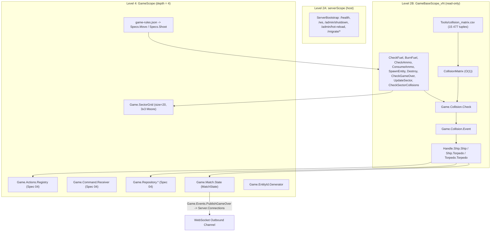

# Спецификация `05`: Матрица коллизий, секторный детектор, минимальный OCP-геймплей и сквозные E2E-тесты с Proxy-агентами

> **Статус:** Zero-Decision Delta Spec (Integration — Все 3 участника команды)  
> **Связанные решения:** [`D-010`, `D-015`, `D-016`, `D-017`, `D-018`, `D-019`, `D-020`](../DECISIONS.md) (поверх сведённого `origin/*` `D-001..D-009` и спецификаций `01..04`)  
> **Зависимости (DAG):** `01-reconciliation-and-value-types.md`, `02-rules-and-scope-hot-reload.md`, `03-server-endpoint-routing-and-step.md`, `04-game-proxy-2proc-migration-and-snapshot.md`  
> **Обязательные инварианты:** [`INV-1..INV-9`](../../.agents/rules/ooand-invariants.md), правила [`docs/ARCHITECTURE.md §5`](../ARCHITECTURE.md)

---

## 1. Контекст, проблема, цели и границы (`Goals` / `Non-Goals`)

### 1.1. Контекст и проблема
После реализации спецификаций `01..04` сервер `SpaceBattle` обладает полным инфраструктурным контуром: compile-once генерацией адаптеров (`[assembly: Dependency]` для производной `Velocity`), декларативными правилами `game-rules.json` с топологической сортировкой Кана (`A before B`), 4-уровневой иерархией скоупов с lock-free hot-reload, WebSocket-эндпоинтом с $O(1)$ роутингом, deadlock-free `GameProxy`, 2-процессной миграцией, `ServerSnapshot` и полными 2PC-транзакциями (`TransactionalGameItem`, `TransactionalGameObjectRepository`, `TransactionalCommandReceiver`).

Для закрытия всех требований защиты (`A1–A11`, `ПЗ_2`, `ПЗ_4`, `ПЗ_6 65:00–70:00`) необходим минимальный интеграционный игровой слой:
1. **Матрица коллизий и секторный индекс:** однократная загрузка `SpaceBattle/Tools/collision_matrix.csv` (15 477 кортежей для радиуса `2.5`) в `GameBaseScope_vN` и регистрация `"Game.Collision.Check"` / `"Game.Collision.Event"` для нетронутой `CheckCollisionCommand` (`INV-3`).
2. **Минимальный OCP-срез геймплея (Контекст 3 Event Storming):** расход топлива (`CheckFuel`/`BurnFuel`), боезапас, универсальный спавн сущностей по имени типа из правил (`SpawnEntityCommand` + `EntitySpawnFactory`, без хардкода под торпеды), уничтожение объектов (`IDestroyingObject`) и простая Read Model завершения матча (`MatchState` + `CheckGameOverCommand`).
3. **Трёхуровневый E2E с Proxy-агентами (`ПЗ_6 69:05`):** (1) детерминированный in-process матч (Игрок 1 молчит → Игрок 2 уничтожает его корабли и побеждает), (2) реальный loopback WebSocket матч через `Program.Main` + `/admin/shutdown`, (3) стыковка живого матча с межпоточной миграцией (`GameProxy`), 2-процессной HTTP-миграцией (`/migrate/start`) и hot-reload `.dll` плагина (`/admin/hot-reload`).

### 1.2. Явные границы (`Non-Goals`, `D-016`)
Не реализуются (в `docs/ROADMAP.md` Deferred Backlog): `Refuel`, `MoveToPoint`, `Meteorites`, `Bonuses`, Контексты 1/2/4 Event Storming, `Saga`, zero-downtime миграция, `Nginx`. Существующие доменные команды (`MoveCommand`, `RotateCommand`, `MacroCommand`, `CheckCollisionCommand`, `ShootCommand`, `MoveTorpedoCommand`, `AuthorizeCommand`, `Game`) **не модифицируются (`INV-3`)**.

### 1.3. Ключевые сценарии (`Given → When → Then`)
1. **Загрузка матрицы коллизий ($O(1)$):** валидный CSV → `IsCollision` возвращает `true`/`false` за $O(1)$; пустой поток, неверный заголовок, не 4 колонки или нецелое значение → `FormatException`.
2. **Секторная коллизия и отсутствие «зомби-столкновений»:** снаряд `#10` сталкивается с кораблём `#1` → `"Game.Collision.Handle.Ship.Torpedo"` уничтожает обоих; цикл `CheckSectorCollisionsCommand` прерывается (`!grid.Contains(10)`), второй корабль `#2` не задет. При совпадении `OwnerId` (дружественный огонь) возвращается `"Commands.Empty"`.
3. **Топливо и откат 2PC (`INV-3`, `D-015`):** `CheckFuel before BurnFuel before Move` внутри `InTransactionCommand` — при `Fuel < FuelConsumption` или сбое после `BurnFuel` `Fuel` и `Position` полностью откатываются.
4. **Откат 2PC при выстреле (0 фантомных сущностей):** при сбое внутри `InTransactionCommand` после `ConsumeAmmo → SpawnEntity` откатываются `Ammo`, сущность в `TransactionalGameObjectRepository` и команда запуска в outbox `TransactionalCommandReceiver`; `SectorGrid` и `ActiveActionRegistry` не мутируются.
5. **Обязательный E2E (`ПЗ_6 69:05`) и ничья:** Игрок 1 молчит (корабли в `(10, 0)` и `(10, 5)`), `ScriptedProxyAgent` Игрока 2 уничтожает оба корабля → `MatchState.IsGameOver == true`, `WinnerPlayerId == "player-2"`, публикация `game_over` и остановка повторителей. При взаимном уничтожении последних кораблей (`Ship.Ship`) → ничья (`WinnerPlayerId == null`).

---

## 2. Архитектура, контракты и альтернативы

### 2.1. Диаграмма взаимодействия подсистем



### 2.2. 5 плоских `-ing` интерфейсов (`INV-5`, `INV-6`)
`AdapterSourceBuilder` (`origin/feature/adapter-codegen`) требует, чтобы адаптируемый интерфейс был **плоским** (`GetInterfaces().Length == 0`) и содержал **только свойства**. Вместо раздутого набора из 8 интерфейсов вводятся ровно **5 плоских `-ing` интерфейсов** (`SpaceBattle.Lib/Interfaces/`):

| Интерфейс | Свойства (точные сигнатуры) | Потребляющие команды |
| :--- | :--- | :--- |
| **`ISectorTrackingObject`** | `int ObjectId { get; }`, `Vector Position { get; }`, `Vector Velocity { get; }`, `string ObjectType { get; }` | `UpdateSectorCommand`, `CheckSectorCollisionsCommand` |
| **`IFuelBurningObject`** | `int Fuel { get; set; }`, `int FuelConsumption { get; }` | `CheckFuelCommand`, `BurnFuelCommand` |
| **`IAmmoConsumingObject`** | `int Ammo { get; set; }` | `CheckAmmoCommand`, `ConsumeAmmoCommand` |
| **`IEntitySpawningObject`** | `int ObjectId { get; }`, `string OwnerId { get; }`, `Vector Position { get; }`, `Angle Angle { get; }`, `int ProjectileSpeed { get; }`, `string ProjectileType { get; }` | `SpawnEntityCommand` |
| **`IDestroyingObject`** | `int ObjectId { get; }`, `string ObjectType { get; }`, `string OwnerId { get; }`, `bool IsAlive { get; set; }` | `DestroyObjectCommand`, `MatchState` |

> *Проверка владельца для дружественного огня (`Ship.Torpedo`) переиспользует уже существующий в Spec `03` ключ `"Game.Item.Owner"` — отдельный `IOwnerCheckingObject` не нужен.*  
> *В `RegisterIoCDependencySectorCollisions.cs` добавляются `[assembly: Dependency]` для `ICollidingObject.Velocity` и `ISectorTrackingObject.Velocity` → `VelocityFromAngleAndSpeedStrategy.Resolve` (Spec `01`, 0 сломанных тестов `origin/*`).*  
> *В `RegisterIoCDependencyCombatCommands.cs` добавляется кодек `typeof(bool)` (`"System.Boolean"`) в `"Snapshot.Codecs"` для сериализации `IsAlive`.*

### 2.3. Стыковка `CheckCollisionCommand` (`origin/main`) и полиморфная диспетчеризация (`INV-2`, `INV-3`)
1. **`IdentifiedCollidingObject : ICollidingObject`** — тонкий декоратор (plain `sealed class`, 0 веток), оборачивающий `ICollidingObject` и добавляющий `ObjectId` и `ObjectType`.
2. **`"Commands.CheckPairCollision"` `(int id1, int id2)`:** читает оба объекта из `"Game.Repository.ReadOnly"`, оборачивает в `IdentifiedCollidingObject` и возвращает `Ioc.Resolve<ICommand>("Commands.CheckCollision", wrapped1, wrapped2)` (вызывая нетронутый `CheckCollisionCommand`).
3. **`"Game.Collision.Event"` `(IdentifiedCollidingObject a, IdentifiedCollidingObject b)`:** нормализует порядок пары (`string.CompareOrdinal(a.ObjectType, b.ObjectType) > 0`) и резолвит `Ioc.Resolve<ICommand>($"Game.Collision.Handle.{first.ObjectType}.{second.ObjectType}", first.ObjectId, second.ObjectId)` (0 `switch`, 0 `is`/`as`; для новых типов сущностей обработчик пары декларативно задаётся в `game-rules.json` `"collisions"` или регистрируется плагином через `IoC.Register`). Если ключ пары не зарегистрирован (исключение `scopes.dll` с сообщением `"The root scope has no a parent scope."`), `"Game.Collision.Event"` делегирует в `"Game.Collision.Default"` (по умолчанию `"Commands.Empty"`, не глуша реальные исключения внутри обработчиков, `D-020`).
4. **Переиспользуемые обработчики пар и дефолты (L2B `GameBaseScope_vN`, `D-020`):**
   - `"Commands.Collision.DestroyBoth"` `(int idA, int idB)` → `[DestroyById(idA), DestroyById(idB), CheckGameOver]`.
   - `"Commands.Collision.DestroyFirst"` `(int idA, int idB)` → `[DestroyById(idA), CheckGameOver]` (асимметричное уничтожение 1-го участника нормализованной пары).
   - `"Commands.Collision.DestroySecond"` `(int idA, int idB)` → `[DestroyById(idB), CheckGameOver]` (асимметричное уничтожение 2-го участника нормализованной пары).
   - `"Commands.Collision.DestroyIfEnemy"` `(int idA, int idB)` → при `ownerA.Length > 0 && ownerA == ownerB` (через `"Game.Item.Owner"`, возвращающий `""` при отсутствии `"OwnerId"` у нейтральных сущностей) возвращает `"Commands.Empty"`, иначе `[DestroyById(idA), DestroyById(idB), CheckGameOver]`.
   - `"Game.Collision.Default"` → `"Commands.Empty"`.
   - Дефолтные пары в L2B (переопределяются per-game через `game-rules.json` `"collisions"` или плагином):
     - `"Game.Collision.Handle.Ship.Ship"` → `"Commands.Collision.DestroyBoth"`.
     - `"Game.Collision.Handle.Ship.Torpedo"` → `"Commands.Collision.DestroyIfEnemy"`.
     - `"Game.Collision.Handle.Torpedo.Torpedo"` → `[DestroyById(idA), DestroyById(idB)]`.

### 2.4. Загрузчик `Tools/collision_matrix.csv` и `SectorGrid`
1. `<None Include="..\Tools\collision_matrix.csv" Link="Tools\collision_matrix.csv" CopyToOutputDirectory="PreserveNewest" />` в `SpaceBattle.Lib.csproj`.
2. **`CollisionMatrixFactory` (`Factory`):** `Load(TextReader reader)` (проверяет заголовок `"dx,dy,ddx,ddy"`, пропускает пустые строки, парсит 4 `int` в `InvariantCulture`, `FormatException` при ошибке) и `LoadFromFile(string filePath)`.
3. **`SectorGrid` (`ISectorGrid`, `ITransactionParticipant`, `D-020`):** `sectorSize = 20` (согласовано с диапазоном матрицы `[-20..20]` и окрестностью Мура $3 \times 3$), координата `(int)Math.Floor((double)coord / _sectorSize)`, методы `UpdateObject`, `RemoveObject`, `Clear`, `Contains`, `GetNeighborIds` (возвращает снапшот `List<int>`). Реализует `ITransactionParticipant` (регистрируется в `GameTransactions` в `RegisterIoCDependencyGameState`): при открытой транзакции журналирует прежнее состояние затронутых `objectId` и на `Rollback()` восстанавливает их за $O(k)$ (исключая рассинхрон `SectorGrid` при откате `Macro.Move`).

### 2.5. Универсальный спавн сущностей и безопасность 2PC (`D-015`, `INV-3`)
1. **`Macro.Move`:** `CheckFuel before BurnFuel before Move before UpdateSector before CheckSectorCollisions` внутри `InTransactionCommand`.
2. **`Macro.Shoot`:** `CheckAmmo before ConsumeAmmo before SpawnEntity` внутри `InTransactionCommand`.
3. **Универсальный спавн по имени типа (`EntitySpawnFactory` вместо захардкоженной `TorpedoFactory`, `D-019`):**
   - `SpawnEntityCommand(IEntitySpawningObject spawner)` вычисляет `spawnPosition` по `(Angle, offset)` с `MidpointRounding.AwayFromZero` (`offset = Ioc.Resolve<int>("Game.Combat.SpawnOffset")`, по умолчанию `3 > 2.5`), вызывает `entityId = Ioc.Resolve<int>("Game.Entity.Create", spawner.ProjectileType, spawner.OwnerId, spawnPosition, spawner.Angle, spawner.ProjectileSpeed)` и `Ioc.Resolve<ICommand>("Game.Entity.Launch", entityId).Execute()`.
   - **`EntitySpawnFactory` (`Factory`):**
     - `Create(string entityType, string ownerId, Vector position, Angle angle, int speed)` — берёт `id` из `"Game.EntityId.Generator"`, вызывает `Ioc.Resolve<IDictionary<string, object>>("Game.Entity.Template.Resolve", entityType)` (базовые свойства шаблона из `game-rules.json` `"templates"`, если задан, иначе пустой словарь), поверх записывает `ObjectId`, `ObjectType = entityType`, `OwnerId`, `Position`, `Angle`, а `Speed` и `IsAlive = true` записывает только если они не заданы явно в шаблоне (`D-020`: стационарная `"Mine"` с `"Speed": 0` в шаблоне не получает фантомную скорость от `spawner.ProjectileSpeed`!), оборачивает через `"Game.Item.Create"` (`TransactionalGameItem`) и записывает в `"Game.Repository.Writable"`. Никакого хардкода под `"Torpedo"` — любая сущность (`"Torpedo"`, `"Rocket"`, `"Mine"`) спавнится тем же кодом!
     - `CreateLaunchCommand(int entityId)` — переиспользует нетронутый `ShootCommand` (`INV-3`) через outbox `"Game.Command.Receiver"` (Spec `04`): на 1-м тике (после `Commit`!) проверяет коллизию в точке спавна (`UpdateSector` + `CheckSectorCollisions`). Далее читает свойство `"TickAction"` у сущности (по умолчанию `"Macro.ProjectileTick"`, зарегистрированный в L2B как `[Commands.Move, Commands.UpdateSector, Commands.CheckSectorCollisions]` либо определённый в `game-rules.json` `"actions"`): если `tickAction == "Commands.Empty"` (например, стационарная `"Mine"`) или сущность погибла в точке спавна (`!grid.Contains(entityId)`), повторяемый тик не запускается; иначе регистрирует `bridge` с `ActionType = tickAction` в `IActiveActionTracking` (`"Game.Actions.Registry"`, Spec `04`) и ставит повторяемый `bridge` в `"Game.Command.Receiver"` (при исключении снимает `bridgeId` из `ActiveActionRegistry` перед пробросом) — тем самым при 2-процессной миграции `Game.Restore` однозначно пересоздаёт тик сущности по `ActiveActionDescriptor.ActionType`! При откате `InTransactionCommand` `ISectorGrid` и `ActiveActionRegistry` не затрагиваются.
4. **Длительные повторяемые действия и управление свойствами по WebSocket (`"Commands.Actions.Start"`, `"Commands.Actions.Stop"`, `"Commands.Properties.Set"`, `D-020`):**
   - `StartActionCommand(int objectId, object targetItem, CommandArguments args)` (через `"Commands.Actions.Start"`, 0 `IDictionary<string, object>` в `*Command.cs` — `objectId` извлекается в инфра-регистраторе `RegisterIoCDependencyCombatCommands`): извлекает `action = args.Get<string>("action")` (и опционально `property_key`), создаёт `ICommandInjecting` (`"Commands.CommandInjectable"`, `Bridge`), инжектирует повторяемый делегат (выполняет `Ioc.Resolve<ICommand>(action, targetItem)` и повторно ставит `bridge` в `"Game.Command.Receiver"`; при исключении снимает `bridgeId` из `"Game.Actions.Registry"` перед пробросом), регистрирует `ActiveActionDescriptor` в `"Game.Actions.Registry"` и отправляет `bridge` в `"Game.Command.Receiver"`.
   - `StopActionCommand(int objectId, CommandArguments args)` (через `"Commands.Actions.Stop"`, 0 `IDictionary<string, object>`): если передан `property_key`, вызывает `registry.Drain(objectId, propertyKey)`, иначе `registry.Drain(objectId)` — и за $O(1)$ подменяет каждый найденный `ICommandInjecting` на `"Commands.Empty"`.
   - `"Commands.Properties.Set"` `(object item, CommandArguments args)`: применяет пары `(key, value)` из `CommandArguments` к объекту через инфра-делегат `RegisterIoCDependencyCombatCommands` (внутри `InTransactionCommand` / `TransactionalGameItem`), позволяя клиенту по WebSocket менять `Speed`, `AngularVelocity`, `ProjectileType` и любые пользовательские свойства без написания новых C#-классов.
5. **Настраиваемая Read Model завершения матча (`MatchState`, `D-019`, `D-020`):**
   - **`MatchState`** (plain `sealed class` в `GameScope` под единым ключом `"Game.Match.State"`): хранит `IReadOnlyCollection<string> Players` (дополняется при `"Game.State.Reindex"` из непустых уникальных `OwnerId` без потери уже выбывших игроков при `Game.Restore`), `bool IsGameOver`, `string? WinnerPlayerId`, метод `IReadOnlyDictionary<string, int> CountAliveTargets(IReadOnlyGameObjectRepository repo, IGameObjectIdSource idSource)` — **разрешает `Ioc.Resolve<string>("Game.Victory.TargetType")` на момент вызова** (устраняет Catch-22 порядка инициализации с `RegisterGameRulesCommand`!), считает живые объекты с `ObjectType == targetType`, `IsAlive == true` по игрокам, и `void Finish(string? winnerPlayerId)`.
   - **`CheckGameOverCommand`:** при `IsGameOver` — `return`; считает игроков с `aliveTargets > 0`; если `> 1` — `return`; иначе вызывает `state.Finish(winner)`, `"Game.Events.PublishGameOver"`(`winner`), `"Game.Finish"`. Переопределяется в `IoC` плагином по OCP (`INV-3`, `D-020`) для альтернативных условий победы (очки, захват, таймер).

### 2.6. Каталог `IoC`-ключей Spec `05`

| Уровень | Ключ `IoC` | Аргументы | Возврат / Контракт | Владелец |
| :- | :--- | :--- | :--- | :--- |
| **L2B** | `"Game.Collision.Matrix"` / `"Game.Collision.Check"` | — / `(dx, dy, ddx, ddy)` | `ICollisionMatrix` / `bool` | `RegisterIoCDependencyCollisionMatrix` |
| **L2B** | `"Commands.CheckCollision"` / `"Commands.CheckPairCollision"` | `(a, b)` / `(idA, idB)` | `ICommand` (единая регистрация `CheckCollision`) | `RegisterIoCDependencySectorCollisions` |
| **L2B** | `"Commands.UpdateSector"` / `"Commands.CheckSectorCollisions"` | `(item)` | `ICommand` | `RegisterIoCDependencySectorCollisions` |
| **L2B** | `"Game.Collision.Event"` / `"Game.Collision.Default"` / `"Game.Collision.Handle.<A>.<B>"` / `"Commands.Collision.{DestroyBoth,DestroyFirst,DestroySecond,DestroyIfEnemy}"` | `(a, b)` / `(idA, idB)` | `ICommand` (`Ship.Ship`, `Ship.Torpedo`, `Torpedo.Torpedo`, fallback `"Commands.Empty"` и переиспользуемые обработчики для `game-rules.json`) | `RegisterIoCDependencyCollisionOutcomes` |
| **L2B** | `"Commands.CheckFuel"` / `"Commands.BurnFuel"` | `(item)` | `ICommand` (оба над `IFuelBurningObject`) | `RegisterIoCDependencyFuelCommands` |
| **L2B** | `"Commands.CheckAmmo"` / `"Commands.ConsumeAmmo"` | `(item)` | `ICommand` (оба над `IAmmoConsumingObject`) | `RegisterIoCDependencyCombatCommands` |
| **L2B** | `"Commands.SpawnEntity"` / `"Commands.Destroy"` / `"Commands.DestroyById"` / `"Commands.CheckGameOver"` | `(item)` / `(id)` / — | `ICommand` | `RegisterIoCDependencyCombatCommands` |
| **L2B** | `"Macro.ProjectileTick"` / `"Commands.Actions.{Start,Stop}"` / `"Commands.Properties.Set"` | `(item)` / `(item, args)` | `ICommand` (тиковый дефолт снаряда, запуск/остановка длительных `Bridge`-действий и изменение свойств по WebSocket) | `RegisterIoCDependencyCombatCommands` |
| **L2B** | `"Game.Entity.Create"` / `"Game.Entity.Launch"` / `"Game.Actions.StopByObject"` | `(type, owner, pos, angle, speed)` / `(id)` | `int` / `ICommand` | `RegisterIoCDependencyCombatCommands` |
| **L2B** | `"Adapters.<I>"` + `"<I.FullName>.<Prop>[.Set]"` | `(item[, val])` | Адаптеры для 5 новых `-ing` интерфейсов + `ICollidingObject` + `IShootingObject` | `RegisterIoCDependency{SectorCollisions,FuelCommands,CombatCommands}` |
| **L4** | `"Game.SectorGrid"` / `"Game.EntityId.Generator"` / `"Game.Match.State"` | — | `ISectorGrid` / `IEntityIdGenerating` / `MatchState` | `RegisterIoCDependencyGameState` |
| **L4** | `"Game.Combat.SpawnOffset"` | — | `int` (по умолчанию `3`) | `RegisterIoCDependencyGameState` |
| **L4** | `"Game.Events.PublishGameOver"` / `"Game.Finish"` / `"Game.State.Reindex"` | `(winner)` / — / `(minNextId)` | `ICommand` (переопределяет L2B no-op `"Game.State.Reindex"` из Spec `02`: индексирует все сущности в `SectorGrid`, синхронизирует `EntityIdGenerator` и `MatchState.Players`) | `RegisterIoCDependencyGameState` |

*(Ключи `"Game.Actions.Registry"`, `"Game.Repository.*"`, `"Game.Command.Receiver"` регистрируются единолично в Spec `04` — 0 дублей `scopes.dll`.)*

### 2.7. Эталонный `game-rules.json` для E2E-матча
```json
{
  "version": "1.0.0",
  "entities": [
    {
      "id": 1,
      "properties": {
        "ObjectId": { "type": "System.Int32", "value": 1 },
        "ObjectType": { "type": "System.String", "value": "Ship" },
        "OwnerId": { "type": "System.String", "value": "player-1" },
        "Position": { "type": "SpaceBattle.Lib.Vector", "value": [10, 0] },
        "Angle": { "type": "SpaceBattle.Lib.Angle", "value": [4, 8] },
        "AngularVelocity": { "type": "SpaceBattle.Lib.Angle", "value": [1, 8] },
        "Speed": { "type": "System.Int32", "value": 0 },
        "Fuel": { "type": "System.Int32", "value": 100 },
        "FuelConsumption": { "type": "System.Int32", "value": 1 },
        "Ammo": { "type": "System.Int32", "value": 5 },
        "ProjectileType": { "type": "System.String", "value": "Torpedo" },
        "ProjectileSpeed": { "type": "System.Int32", "value": 5 },
        "IsAlive": { "type": "System.Boolean", "value": true }
      }
    },
    {
      "id": 2,
      "properties": {
        "ObjectId": { "type": "System.Int32", "value": 2 },
        "ObjectType": { "type": "System.String", "value": "Ship" },
        "OwnerId": { "type": "System.String", "value": "player-1" },
        "Position": { "type": "SpaceBattle.Lib.Vector", "value": [10, 5] },
        "Angle": { "type": "SpaceBattle.Lib.Angle", "value": [4, 8] },
        "AngularVelocity": { "type": "SpaceBattle.Lib.Angle", "value": [1, 8] },
        "Speed": { "type": "System.Int32", "value": 0 },
        "Fuel": { "type": "System.Int32", "value": 100 },
        "FuelConsumption": { "type": "System.Int32", "value": 1 },
        "Ammo": { "type": "System.Int32", "value": 5 },
        "ProjectileType": { "type": "System.String", "value": "Torpedo" },
        "ProjectileSpeed": { "type": "System.Int32", "value": 5 },
        "IsAlive": { "type": "System.Boolean", "value": true }
      }
    },
    {
      "id": 3,
      "properties": {
        "ObjectId": { "type": "System.Int32", "value": 3 },
        "ObjectType": { "type": "System.String", "value": "Ship" },
        "OwnerId": { "type": "System.String", "value": "player-2" },
        "Position": { "type": "SpaceBattle.Lib.Vector", "value": [0, 0] },
        "Angle": { "type": "SpaceBattle.Lib.Angle", "value": [0, 8] },
        "AngularVelocity": { "type": "SpaceBattle.Lib.Angle", "value": [1, 8] },
        "Speed": { "type": "System.Int32", "value": 1 },
        "Fuel": { "type": "System.Int32", "value": 100 },
        "FuelConsumption": { "type": "System.Int32", "value": 1 },
        "Ammo": { "type": "System.Int32", "value": 5 },
        "ProjectileType": { "type": "System.String", "value": "Torpedo" },
        "ProjectileSpeed": { "type": "System.Int32", "value": 5 },
        "IsAlive": { "type": "System.Boolean", "value": true }
      }
    }
  ],
  "actions": {
    "Move": {
      "steps": ["Commands.CheckFuel", "Commands.BurnFuel", "Commands.Move", "Commands.UpdateSector", "Commands.CheckSectorCollisions"],
      "order": [
        "Commands.CheckFuel before Commands.BurnFuel",
        "Commands.BurnFuel before Commands.Move",
        "Commands.Move before Commands.UpdateSector",
        "Commands.UpdateSector before Commands.CheckSectorCollisions"
      ]
    },
    "Rotate": { "steps": ["Commands.Rotate"], "order": [] },
    "Shoot": {
      "steps": ["Commands.CheckAmmo", "Commands.ConsumeAmmo", "Commands.SpawnEntity"],
      "order": [
        "Commands.CheckAmmo before Commands.ConsumeAmmo",
        "Commands.ConsumeAmmo before Commands.SpawnEntity"
      ]
    }
  }
}
```

---

## Detailed Implementation Plan

### 3.1. Список файлов (`Create` и `Modify`)

#### A. Изменения проекта (`Modify`)
| Файл (`SpaceBattle/...`) | Действие | Контракт изменений |
| :--- | :---: | :--- |
| `SpaceBattle.Lib/SpaceBattle.Lib.csproj` | `Modify` | Добавить `<None Include="..\Tools\collision_matrix.csv" Link="Tools\collision_matrix.csv" CopyToOutputDirectory="PreserveNewest" />`. |
| `SpaceBattle.Server/ServerBootstrap.cs` | `Modify` | Подключить в L2A `serverScope`: `RegisterIoCDependencyScopeHierarchy` (Spec `02`) и привязку `"Server.Admin.HotReload"` → `"Scopes.HotReload"`; в `baseInitializer` (L2B `GameBaseScope_vN`): `RegisterIoCDependencyCollisionMatrix`, `RegisterIoCDependencySectorCollisions`, `RegisterIoCDependencyCollisionOutcomes`, `RegisterIoCDependencyFuelCommands`, `RegisterIoCDependencyCombatCommands`; при создании `GameScope` (L4): `RegisterIoCDependencyGameState`. |
| `SpaceBattle.Lib/Transfer/RegisterIoCDependencyTransferableGame.cs` | `Modify` | В `Game.Restore` после восстановления сущностей вызывать `"Game.State.Reindex"` с `snapshot.NextEntityId`. |

#### B. 5 плоских `-ing` интерфейсов (`Create` — `SpaceBattle.Lib/Interfaces/`)
| Файл | Точная сигнатура |
| :--- | :--- |
| `Interfaces/ISectorTrackingObject.cs` | `public interface ISectorTrackingObject { int ObjectId { get; } Vector Position { get; } Vector Velocity { get; } string ObjectType { get; } }` |
| `Interfaces/IFuelBurningObject.cs` | `public interface IFuelBurningObject { int Fuel { get; set; } int FuelConsumption { get; } }` |
| `Interfaces/IAmmoConsumingObject.cs` | `public interface IAmmoConsumingObject { int Ammo { get; set; } }` |
| `Interfaces/IEntitySpawningObject.cs` | `public interface IEntitySpawningObject { int ObjectId { get; } string OwnerId { get; } Vector Position { get; } Angle Angle { get; } int ProjectileSpeed { get; } string ProjectileType { get; } }` |
| `Interfaces/IDestroyingObject.cs` | `public interface IDestroyingObject { int ObjectId { get; } string ObjectType { get; } string OwnerId { get; } bool IsAlive { get; set; } }` |

#### C. Коллизии (`Create` — `SpaceBattle.Lib/Collisions/`)
| Файл | Тип / Маркер | Контракт |
| :--- | :--- | :--- |
| `Collisions/ICollisionMatrix.cs` | Interface | `bool IsCollision(int dx, int dy, int ddx, int ddy); int Count { get; }` |
| `Collisions/CollisionMatrix.cs` | `sealed class` | `HashSet<(int, int, int, int)>` lookup, иммутабельна. |
| `Collisions/CollisionMatrixFactory.cs` | `sealed class` (`Factory`) | `Load(TextReader)`, `LoadFromFile(string)`. |
| `Collisions/ISectorGrid.cs` | Interface | `UpdateObject`, `RemoveObject`, `Clear`, `Contains`, `GetNeighborIds`. |
| `Collisions/SectorGrid.cs` | `sealed class : ISectorGrid, ITransactionParticipant` | Окрестность Мура $3 \times 3$, `sectorSize = 20`, `(int)Math.Floor((double)c / _sectorSize)`, очистка пустых бакетов, `Clear()`, откат затронутых позиций на 2PC `Rollback()`. |
| `Collisions/IdentifiedCollidingObject.cs` | `sealed class : ICollidingObject` | Декоратор `(int objectId, string objectType, ICollidingObject inner)`. |
| `Collisions/UpdateSectorCommand.cs` | `sealed class : ICommand` | Обновляет позицию `ISectorTrackingObject` в `"Game.SectorGrid"`. |
| `Collisions/CheckSectorCollisionsCommand.cs` | `sealed class : ICommand` | Обходит `GetNeighborIds`, проверяя `grid.Contains(self)` и `grid.Contains(neighbor)` (защита от зомби-коллизий). |
| `Collisions/RegisterIoCDependencyCollisionMatrix.cs` | `Register` | Регистрирует `"Game.Collision.Matrix"` и `"Game.Collision.Check"`. |
| `Collisions/RegisterIoCDependencySectorCollisions.cs` | `Register` | `[assembly: Dependency]` для `Velocity`, адаптеры `ICollidingObject`/`ISectorTrackingObject`, команды `CheckCollision`, `CheckPairCollision`, `UpdateSector`, `CheckSectorCollisions`. |
| `Collisions/RegisterIoCDependencyCollisionOutcomes.cs` | `Register` | Канонический `"Game.Collision.Event"` (с fallback на `"Game.Collision.Default"`), переиспользуемые `"Commands.Collision.{DestroyBoth,DestroyFirst,DestroySecond,DestroyIfEnemy}"` и дефолты `Ship.Ship`, `Ship.Torpedo`, `Torpedo.Torpedo` (0 `switch`). |

#### D. Геймплей (`Create` — `SpaceBattle.Lib/Gameplay/`)
| Файл | Тип / Маркер | Контракт |
| :--- | :--- | :--- |
| `Gameplay/CheckFuelCommand.cs` | `sealed class : ICommand` | Ctor `(IFuelBurningObject)`: `Fuel < FuelConsumption` → `InvalidOperationException`. |
| `Gameplay/BurnFuelCommand.cs` | `sealed class : ICommand` | Ctor `(IFuelBurningObject)`: `Fuel -= FuelConsumption`. |
| `Gameplay/CheckAmmoCommand.cs` | `sealed class : ICommand` | Ctor `(IAmmoConsumingObject)`: `Ammo <= 0` → `InvalidOperationException`. |
| `Gameplay/ConsumeAmmoCommand.cs` | `sealed class : ICommand` | Ctor `(IAmmoConsumingObject)`: `Ammo -= 1`. |
| `Gameplay/SpawnEntityCommand.cs` | `sealed class : ICommand` | Ctor `(IEntitySpawningObject)`: вычисляет `spawnPosition` по `(Angle, offset)`, вызывает `"Game.Entity.Create"` и `"Game.Entity.Launch"` (чистая транзакция). |
| `Gameplay/DestroyObjectCommand.cs` | `sealed class : ICommand` | Ctor `(IDestroyingObject)`: ранний `return` при `!IsAlive`; иначе `IsAlive = false`, `"Game.Actions.StopByObject"`, `SectorGrid.RemoveObject`, `Repository.Remove`. |
| `Gameplay/IEntityIdGenerating.cs` | Interface (`-ing`) | `NextId()`, `PeekNextId()`, `SyncMinNextId(int)`. |
| `Gameplay/EntityIdGenerator.cs` | `sealed class` | Монотонный генератор ID (`initialNextId >= 1`). |
| `Gameplay/MatchState.cs` | `sealed class` | Простая Read Model: `TargetObjectType` (из `"Game.Victory.TargetType"`), `Players` (с сохранением выбывших), `IsGameOver`, `WinnerPlayerId`, `CountAliveTargets(repo, idSource)`, `Finish(winner)`. |
| `Gameplay/CheckGameOverCommand.cs` | `sealed class : ICommand` | Ctor `(MatchState)`: при `<= 1` живом игроке вызывает `Finish`, `"Game.Events.PublishGameOver"`, `"Game.Finish"`. |
| `Gameplay/EntitySpawnFactory.cs` | `sealed class` (`Factory`) | Универсальный `Create(entityType, ownerId, pos, angle, speed)` (через `"Game.Entity.Template.Resolve"`) и `CreateLaunchCommand(entityId)` через `ShootCommand`, свойство `"TickAction"` / `"Macro.ProjectileTick"` и outbox `"Game.Command.Receiver"` (поддержка стационарных сущностей при `"Commands.Empty"`). |
| `Gameplay/RegisterIoCDependencyFuelCommands.cs` | `Register` | Адаптер `IFuelBurningObject`, `"Commands.CheckFuel"`, `"Commands.BurnFuel"`. |
| `Gameplay/RegisterIoCDependencyCombatCommands.cs` | `Register` | Кодек `bool`, адаптеры `IAmmoConsumingObject`, `IEntitySpawningObject`, `IDestroyingObject`, `IShootingObject`, команды `CheckAmmo`, `ConsumeAmmo`, `SpawnEntity`, `Destroy`, `DestroyById`, `CheckGameOver`, `"Macro.ProjectileTick"`, `"Commands.Actions.{Start,Stop}"` (0 `IDictionary` в `*Command.cs`), `"Commands.Properties.Set"`, стратегии `Game.Entity.{Create,Launch}`, `Game.Actions.StopByObject`. |
| `Gameplay/RegisterIoCDependencyGameState.cs` | `Register` | Регистрирует в `GameScope` `"Game.SectorGrid"` (с `transactions.RegisterParticipant(grid)`), `"Game.EntityId.Generator"`, `"Game.Match.State"`, `"Game.Combat.SpawnOffset"`, `"Game.Events.PublishGameOver"`, `"Game.Finish"`, `"Game.State.Reindex"` (вызывает `grid.Clear()`, индексирует живые сущности и дополняет `MatchState.Players` непустыми `OwnerId` без сброса). |

#### E. Тесты и 3-уровневый E2E (`Create` — `SpaceBattle.Tests/`)
| Файл | Обязательные кейсы (100% Line & Branch) |
| :--- | :--- |
| `CollisionsTests/CollisionMatrixFactoryTests.cs` | `Load(StringReader)` (хит/промах, пустые строки, ошибки заголовка/колонок/чисел), `LoadFromFile` (пустой путь, реальный `Tools/collision_matrix.csv` на 15 477 записей), `RegisterIoCDependencyCollisionMatrix`. |
| `CollisionsTests/SectorGridTests.cs` | Невалидный `sectorSize`, отрицательные/положительные секторы, повторный `UpdateObject` в том же секторе, перемещение между секторами и очистка пустых бакетов, `RemoveObject`, `GetNeighborIds` ($3 \times 3$). |
| `CollisionsTests/SectorCollisionCommandsTests.cs` | `IdentifiedCollidingObject`, `UpdateSectorCommand`, `CheckSectorCollisionsCommand` (0 соседей, 2 соседа, ранний выход при гибели источника, `continue` при гибели соседа), `RegisterIoCDependencySectorCollisions`. |
| `CollisionsTests/CollisionOutcomeDispatchTests.cs` | `Ship.Ship`, `Ship.Torpedo` (вражеский удар и дружественный огонь через `"Game.Item.Owner"`), `Torpedo.Ship` (нормализация порядка), `Torpedo.Torpedo`, кастомная пара из `game-rules.json` `"collisions"` (через `"Commands.Collision.DestroyBoth"` / `"Commands.Collision.DestroyIfEnemy"` / `"Commands.Empty"`), неизвестная пара. |
| `GameplayTests/FuelCommandsTests.cs` | `CheckFuelCommand` (`>`, `==`, `<`), `BurnFuelCommand`, `RegisterIoCDependencyFuelCommands`, макро-сборка и 2PC-откат. |
| `GameplayTests/CombatAndDestroyCommandsTests.cs` | `CheckAmmoCommand`, `ConsumeAmmoCommand`, `SpawnEntityCommand`, `EntitySpawnFactory` (чистый выстрел с тиком `bridge` и `TickAction`, стационарная `"Mine"` с `TickAction = "Commands.Empty"`, столкновение в точке спавна, 2PC-откат без фантомной сущности, спавн кастомного типа сущности из `game-rules.json` `"templates"`, `bool`-кодек), `"Commands.Actions.{Start,Stop}"` (запуск и $O(1)$ остановка длительного действия по WebSocket), `DestroyObjectCommand` (живой/мёртвый), `EntityIdGenerator`. |
| `GameplayTests/MatchStateAndGameOverTests.cs` | `MatchState.CountAliveTargets` (фильтрация по настраиваемому `TargetObjectType` — `"Ship"` и кастомный `"Cruiser"` из `"victory_target"`, `IsAlive`, `Players` без потери выбывших), `CheckGameOverCommand` (`IsGameOver == true`, `>= 2` игроков, `1` победитель, `0` ничья), `"Game.State.Reindex"`, `"Game.Finish"`, `"Game.Events.PublishGameOver"` (`"Server.Connections"` и headless). |
| `E2E/ScriptedProxyAgent.cs` | Proxy-агент (`Silent` и `Scripted`) для in-process и `ClientWebSocket` (`CloseAsync`). |
| `E2E/InProcessMatchE2ETests.cs` | Слой 1: эталон `ПЗ_6 69:05`, 2PC-откат, сосуществование 2 `game-rules.json`, `AuthorizeCommand`. |
| `E2E/WebSocketMatchE2ETests.cs` | Слой 2: `Program.Main` + 2 `ClientWebSocket` агента + `state`/`game_over` + `CloseAsync` + `/admin/shutdown`. |
| `E2E/ConcurrencyMigrationAndHotReloadE2ETests.cs` | Слой 3: межпоточная миграция (`GameProxy`), 2-серверная HTTP-миграция (`/migrate/start`) с доигрыванием до победы, hot-reload Roslyn `.dll` плагина через `POST /admin/hot-reload`. |

---

### 3.2. Команды верификации
```bash
set -o pipefail
python3 .agents/hooks/ooand-lint-gate.py --check-all .
dotnet format SpaceBattle/SpaceBattle.sln --verify-no-changes
dotnet build SpaceBattle/SpaceBattle.sln --no-incremental
dotnet test SpaceBattle/SpaceBattle.sln --no-build --collect:"XPlat Code Coverage"
python3 .agents/hooks/stop-verify-gate.py --verify-coverage-only .
```
